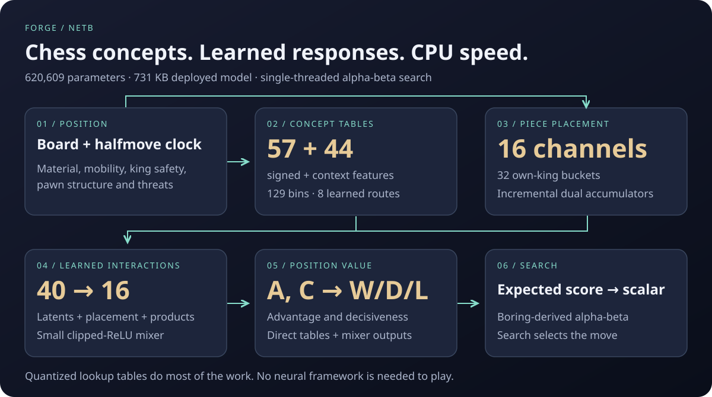

# FORGE

**New: [FORGE 2 — complete engine book and source](forge2/README.md)** ·
[Dedicated v2.0.0 source release](https://github.com/vikta03/forge/releases/tag/v2.0.0).
A learned placement evaluator, its training pipeline, optional quiet policy and
recorded experiments. The earlier netB engine below and its release remain intact.

**A compact CPU chess engine that learns how chess concepts and piece placement fit together.**

By **Remmy Victor · [@vikta03](https://github.com/vikta03)**.
FORGE netB 1.0.0 combines a **620,609-parameter learned evaluator**, a
**730,614-byte deployed model** (731 KB decimal; 714 KiB), and the alpha-beta
search developed in my earlier engine, **Boring**.



FORGE is the CPU counterpart to my [VEGAM](https://github.com/vikta03/vegam)
transformer engine. FORGE starts with explicit chess concepts and learns their
responses and interactions; VEGAM learns from board and history tensors.
This project documents FORGE's engineering and experiments without claiming
an established external rating or superiority to VEGAM.

## Play

Download the Linux package and `SHA256SUMS` from
[netB v1.0.0 release](https://github.com/vikta03/forge/releases/tag/v1.0.0).
The package contains the executable, launcher, exact netB-best runtime weights,
licences and verification receipts.

```bash
sha256sum --ignore-missing -c SHA256SUMS
tar -xzf forge-netB-1.0.0-linux-x86_64-avx2.tar.gz
cd forge-netB-1.0.0
./forge
```

In a UCI chess GUI, select the extracted **`forge`** executable. No arguments,
working-directory setting, GPU runtime or model selection are needed.
Use Linux x86-64 with a **Haswell-compatible CPU** (AVX2, FMA and BMI1/2).
The distributed binary is built on **Ubuntu 22.04** using GCC 12; ordinary
glibc and libstdc++ are required. Other operating systems and older CPUs are
not covered by this release.

The launcher loads `models/netB-best.forge` relative to its own directory,
including when the path contains spaces. `FORGE_NET=/path/to/model.forge`
overrides it at launch; UCI **NetPath** remains available after startup.
Missing or incompatible weights produce an explicit error. Leave the shipped
search settings unchanged for the documented configuration.

## Inside one evaluation

1. **Board → concepts.** Boring's evaluator extracts material, mobility, pawn
   structure, king safety, threats and related quantities. netB retains **57
   signed features** and **44 context features**. The halfmove clock is an input.
2. **Concepts → learned tables.** Each quantity selects one of **129 bins**.
   The signed branch keeps the sign separately. Model-stored phase/pawn-count
   maps choose among **eight routes**, independently for advantage and decisiveness.
3. **Placement → spatial information.** A **16-channel embedding** represents
   all pieces in a side-to-move frame, conditioned on one of **32 own-king
   buckets**. Two perspectives update incrementally during make/unmake;
   a changed king bucket refreshes that perspective.
4. **Interactions → mixer.** Eight signed and eight context latent channels,
   the 16 placement channels, and eight `tanh(odd) × sigmoid(context)`
   channels form **40 inputs** to a **16-unit clipped-ReLU mixer**.
5. **Evaluation → search.** The direct tables and mixer produce advantage
   **A** and decisiveness **C**. With `q = sigmoid(A)` and `c = sigmoid(C)`:
   **W = cq**, **D = 1−c**, **L = c(1−q)**. The expected score
   `E = W + D/2` becomes `187 × log(E/(1−E))`, rounded into the scalar
   used by alpha-beta. The runtime uses a numerically stable equivalent.

The deployed direct tables are int16; latent and placement tables are int8;
the small mixer uses floating point. Playing requires **no PyTorch and no GPU**.
Specialized inherited endgame evaluation and an optional Syzygy interface remain;
FORGE does not claim every position is answered solely by the learned model.

Read the [worked netB evaluation](docs/evaluation.md) and reproduce it with
`forgeinspect` and [the independent replay](tools/replay.py). Direct feature
contributions are inspectable. Latent channels are learned combinations:
this documentation does not assign them invented chess meanings.

## What the experiments actually found

The four-arm feature experiment used one seed, matching initialization and
training settings. Best checkpoints were selected by validation cross entropy.

| Arm | Inputs | Description | Offline top-one move agreement |
|---|---:|---|---:|
| net0 | 49 | Base concepts | 39.27% |
| netA | 83 | Add previously discarded internal terms | 41.01% |
| **netB** | **101** | Internal terms plus new concepts | **43.98%** |
| netC | 67 | New concepts only | 42.77% |

The historical netB-best binary then scored **47 wins, 103 draws and 50
losses** in 200 games at **8 seconds + 0.08 seconds/move** against the
older next-strength engine: **49.25%**. That result does **not** establish
a playing-strength gain. The opponent was not the matched net0 training control,
so this match also does not isolate the effect of the new features.

The saved [10,000-position parity receipt](evidence/historical-parity.json)
reported zero integer-score/search-score/route mismatches between the
checkpoint/export path and the historical binary.
[Full PGN](evidence/netB-best-vs-next-strength-200.pgn) ·
[Training records](evidence/training) · [Evidence and limitations](docs/evidence.md).

## What changed for publication

The learned model, evaluation algebra, pruning settings and search defaults
remain those of netB-best. The focused correctness change is a
[halfmove-clock tag for cached static evaluations](docs/cache-correction.md).
The same board at different clocks can receive different neural evaluations;
main search and quiescence now refuse a static score cached at another clock.
Search-bound identity and the 32-byte table cluster layout are preserved.
Clock-tag memory counts toward the requested Hash size.

Historical match results belong to the **historical binary**, not this corrected
release. J32 and CI verify correctness, packaging and a small timing comparison;
they do not measure strength.

## Build, inspect and train

```bash
# Ubuntu 22.04
sudo apt-get update
sudo apt-get install g++-12
CXX=g++-12 ./build.sh
python3 tools/fetch_model.py
./forge
```

The fixed `-march=haswell -mtune=generic` target replaces machine-dependent
`-march=native`. Source builds need only a C++20 compiler and the standard runtime.
[Build and GUI instructions](docs/installation.md) include protocol checks.

The [training guide](docs/training.md) includes architecture, configurable
extraction, training and export commands. The surviving checkpoint is released
as weights only. **The original full training corpus is not included and its
previous configured paths are incomplete.** Repeating the historical training
requires obtaining the documented external inputs; downloading this repository
alone is insufficient.

## Provenance and licences

FORGE's learned evaluation is the subsequent development of my Boring engine.
The source retains Boring's namespace and implementation history references.
The release has fresh Git history; the original repositories and research
archive remain preserved.

**Code: GPLv3. Original model weights and writing: CC BY 4.0.**
Vendored Fathom retains its MIT licence and named copyright holders.
See [licensing](LICENSE.md), [third-party notices](THIRD_PARTY.md) and
[source provenance](provenance/imports.json).
