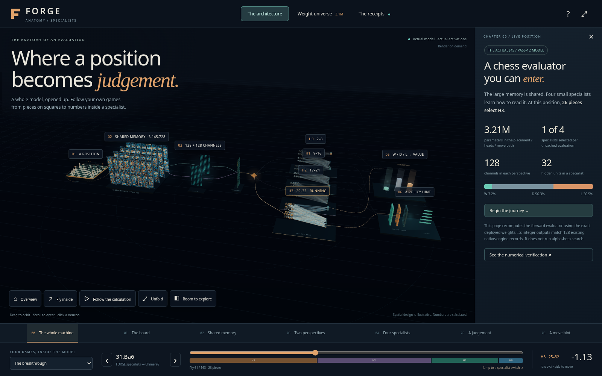

# FORGE
### Teach it chess. Make every CPU cycle count.

**My family of learned chess engines—trained on 213.9 million positions,
built to play on a CPU, and opened up so you can see how they work.**

**Remmy Victor · [@vikta03](https://github.com/vikta03)**

[Get the current source + models](https://github.com/vikta03/forge/releases/tag/research-2026-10-26) · [See inside](forge-next/visuals/README.md) · [Build Wide192](forge-next/BUILD.md) · [Read the results](forge-next/EVIDENCE.md)

**A chess engine is more than a model.** I design and train the evaluator,
make it cheap enough to call millions of times during search, test it in games,
and investigate the positions where it goes wrong.

| In 30 seconds | What makes this project interesting |
|---|---|
| **Learned chess judgement** | Pieces become learned vectors. Small specialist networks turn them into position evaluations and move-ordering advice. |
| **CPU-first engineering** | Wide192's runtime weights occupy **4.80 MB**. Incremental updates reuse most of the previous board calculation; playing needs no GPU or PyTorch. |
| **Real experiments** | Trained variants, 400-game comparisons, source-game uncertainty estimates, search regressions and the results that did not work. |
| **You can look inside** | A 3D explorer with actual weights and checked arithmetic, illustrated architecture comparisons, and a complete engine guide. |

## Start somewhere interesting

**[Enter the network →](forge-next/visuals/README.md)**
Explore the earlier four-head Specialists model, inspect connections and follow
a position into its numerical evaluation. The visual layout is illustrative;
the forward arithmetic was checked against 128 saved native positions.

**[Meet Wide192 →](forge-next/ARCHITECTURES.md)**
The current daily driver: two 192-channel views of the board, one selected
32-unit reader, and a learned quiet-move policy. Compare it with Wide160,
Deep32 and Reader64, and see why bigger did not always mean better.

**[Follow a failure →](forge-next/evidence/J77/RESULTS.md)**
Why can a network confidently call a drawn ending winning? A comparison with
Stockfish separates what the evaluator knows before searching from what search
discovers later. The follow-up repetition experiment and its limitations are
published too.

**[Read the complete FORGE 2 guide →](forge2/ENGINE_GUIDE.md)**
An extensive explanation of the original placement engine, from board encoding
and quantized arithmetic to search, training, policy and experiments.

## Source, models and honest results

**[26 October research snapshot](forge-next/README.md):** eight exact native
source variants, five distinct trained runtime models, training/export code,
adopted search corrections, diagnostic receipts and match PGNs. This release
provides source and weights; build instructions are included.

In the 400-game short-clock comparison, Wide192 scored **113 wins, 171 draws,
116 losses** against Wide160: no strength difference was resolved. Reader64's
larger readers improved a validation metric but lost their screen against
Wide192. [Conditions, confidence intervals and regressions](forge-next/EVIDENCE.md)
stay beside the claims. No external Elo rating is claimed.

FORGE's alpha-beta foundation comes from **Boring, my earlier engine**. The
newer models learn placement representations; the original netB used learned
responses to explicit chess concepts. Third-party source lineage is retained.

**Older releases remain available:** [netB v1: ready Linux package](https://github.com/vikta03/forge/releases/tag/v1.0.0) ·
[netB explanation](NETB_README.md) · [FORGE 2 v2: source edition](https://github.com/vikta03/forge/releases/tag/v2.0.0).

## Another way to think about chess

**[VEGAM](https://github.com/vikta03/vegam)** is my transformer counterpart:
learned board/history representations, attention and GPU inference, paired with
Lc0-derived search. Its illustrated book follows a single bishop move through
the network. These are complementary approaches, not comparable NPS counters.

Code: **GPL-3.0-or-later**. Original model weights, writing and illustrations:
**CC BY 4.0**. [Licence boundaries](forge-next/LICENSE.md) ·
[Source provenance](forge-next/SOURCE_PROVENANCE.json).
