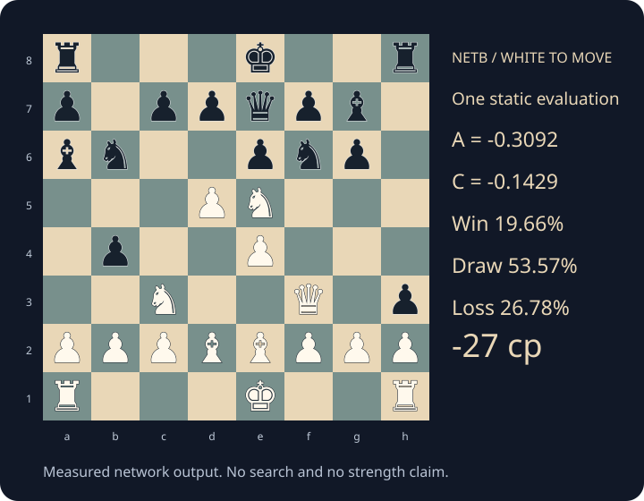

# Open one evaluation



This crowded middlegame has both castling rights, central tension, vulnerable
kings and several minor-piece interactions. It is a useful accounting example,
not a claim about the position's best move.

```text
r3k2r/p1ppqpb1/bn2pnp1/3PN3/1p2P3/2N2Q1p/PPPBBPPP/R3K2R w KQkq - 0 1
```

**White to move.** Everything below is one static neural evaluation, before
alpha-beta searches any continuation. The raw diagnostic trace and numeric
receipt are in [the example data](../evidence/worked-evaluation.json).

## Follow the numbers

1. The board produces 57 signed features and 44 context features. Each selects
   a bin from 0 to 128. Signed features retain a separate sign; a context bin
   is centred at 64. A bin index is not a centipawn score.
2. The model selects **advantage route 7** and **decisiveness route
   7** from phase and total pawn count. Its own-king placement bucket
   is **4**. These are learned routing choices, not named strategies.
3. The signed direct-table sum is **-8734 integer units**, scaled to
   **-0.50063038** advantage logit. The context sum is **-12912
   integer units**; its scale and bias give **-0.72753459** decisiveness logit.
4. The 8 signed, 8 context and 16 placement channels form 32 pooled values.
   Eight gated products make 40 mixer inputs. The 16 clipped-ReLU outputs
   contribute **+0.19143168** to advantage and **+0.58465405**
   to decisiveness.
5. Add the two branches: **A = -0.30919870** and **C = -0.14288054**.
   Then `q = sigmoid(A) = 0.42331034` and
   `c = sigmoid(C) = 0.46434051`.
6. **W = 0.19656014**, **D = 0.53565949**,
   **L = 0.26778037**. Their sum is one.
   These are the network's predictions, not guaranteed outcome frequencies.
7. `E = W + D/2 = 0.46438988`.
   `187 × log(E/(1−E)) = -26.681541`.
   The runtime reports **-27 cp**.
   Its search readout is **-27 cp**.

## The largest direct responses

The following are the six largest absolute direct contributions in each branch.
They are measured contributions to **A or C**, not independent material values
and not a causal explanation of the eventual searched move.

| Branch | Feature | Raw input | Bin | Direct logit contribution |
|---|---|---:|---:|---:|
| Signed | threatSafePawn difference | -1 | 64 | -0.328499 |
| Signed | THREATS.eg diff | -107 | 27 | -0.141924 |
| Signed | ROOK_MOB.eg diff | -60 | 30 | -0.100424 |
| Signed | space diff | 70 | 35 | -0.092342 |
| Signed | THREATS.mg diff | -168 | 42 | -0.086667 |
| Signed | shelterMg difference | 110 | 28 | +0.082598 |
| Context | THREATS.mg sum | 520 | 96 | -0.281170 |
| Context | maxHangingVictim total | 370 | 76 | -0.147584 |
| Context | THREATS.eg sum | 379 | 88 | +0.132722 |
| Context | threatSafePawn total | 1 | 96 | +0.131800 |
| Context | hangingMaterial total | 370 | 70 | +0.131685 |
| Context | |boring score| | 54 | 66 | -0.079495 |

The mixer can reinforce or counteract these contributions. Removing a piece
changes many features and routes together; a row cannot be interpreted as
“the value of that piece.”

## Every pooled channel

Signed latents: `-0.86978, +0.48502, -2.67572, -0.15721, -0.44768, -1.52425, -0.98936, -0.68645`.

Context latents: `+1.67258, -0.58028, -0.99897, -1.10645, -1.39559, -4.23325, +1.92372, -3.89855`.

Placement channels: `+0.10868, +0.72592, -3.37341, -2.14046, +0.64155, -0.48390, -1.84094, -1.82121, +1.17728, -2.83103, +0.56213, +1.09548, -2.03268, -0.64450, -0.45679, -3.61724`.

Activated mixer units: `+1.45924, +0.00000, +0.00000, +0.49200, +0.00000, +0.00000, +0.28067, +1.32548, +0.57525, +0.00000, +1.00176, +2.66656, +0.00000, +0.00000, +0.00000, +1.12070`.

These vectors are real measurements. Their coordinates are learned and are
not labelled “king safety neuron” or “passed-pawn neuron” without further
controlled evidence.

## Verify it

Send `position fen ...` followed by `forgeinspect` to the launcher, save the
output as `trace.txt`, then run:

```bash
python tools/replay.py trace.txt --json replay.json
```

The Python replay independently reads the quantized model, constructs bins,
sums tables and placement embeddings, runs the mixer and calculates W/D/L.
Its maximum A/C disagreement with this C++ evaluation is
**5.24164508e-08**, against a gate of 0.00003.
Small floating-point differences can exist across compilers; the receipt
records them rather than claiming every intermediate is bit-identical.
