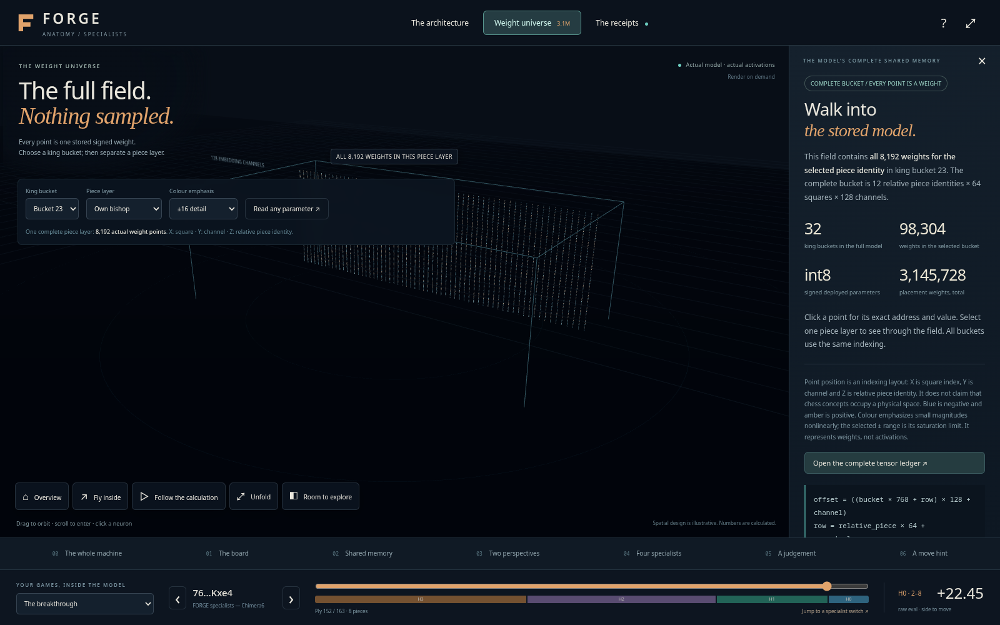
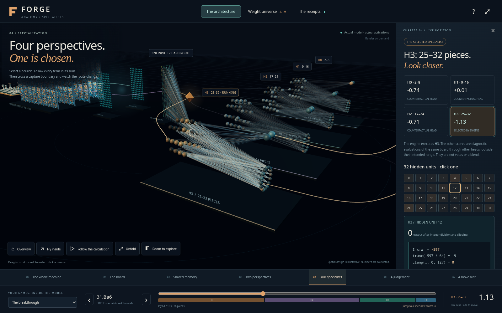
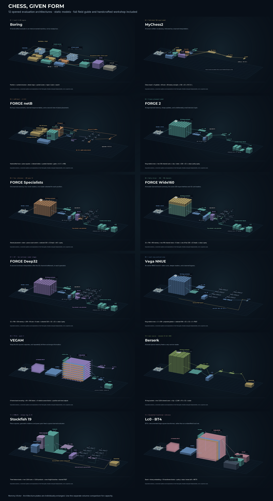

# See the engine before reading the code

**[Download the visual collection](https://github.com/vikta03/forge/releases/download/research-2026-10-26/forge-visuals-2026-10-26.tar.gz)**,
extract it, and open `explorer/forge-anatomy.html` in a modern browser. The
standalone page works offline, with its model and Three.js embedded. GitHub
displays the HTML source rather than executing it in a repository view.

## The anatomy explorer

Fly through the trained **Specialists** model, select components, inspect
weights and channels, and follow the actual forward evaluation of saved game
positions. It embeds the entire model and checks its arithmetic against 128
saved native-engine positions. Spatial placement and travelling light are
illustration; the displayed numerical forward pass is computed.

This is the 128-channel Specialists model, **not** a live interface to the
current Wide192 search. It does not invent human names for latent neurons.
Read [Accuracy](explorer/ACCURACY.md) for exactly what was verified and what
the scene omits, and [verification limits](explorer/VERIFICATION.md) for the
scope of interaction checks.

## Chess, given form

Open `gallery/chess-in-form.html` in the same archive for the architectural
gallery, then `gallery/handcrafted.html` and `gallery/notes.html` for the
handwritten evaluators and field notes. These illustrated schematics compare
FORGE, VEGAM, earlier projects and selected outside engines. They are not
silicon models, benchmarks or a neuron-per-weight representation.

The gallery preserves its original dated scope, including Wide160/Deep32;
the latest Wide192/Reader64 dimensions are in [the architecture table](../ARCHITECTURES.md).
Capacity-cube scale is a stored-parameter comparison, not playing strength.
Source citations and conventions are in [Sources](gallery/SOURCES.md).

Source modules for the explorer are included here. To regenerate the standalone
page, also obtain the model-bearing `atlas-data.json` and vendored Three.js from
the visual release archive, preserving the recorded checksums. The original
`build.py` verifies those identities and the saved interaction-source receipt.
