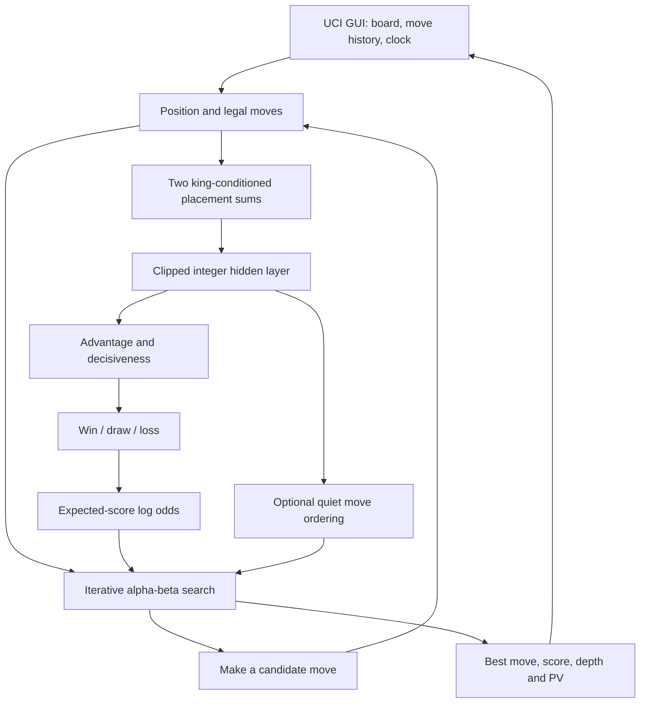

# FORGE 2: a complete engine, from board to decision

**Remmy Victor · [@vikta03](https://github.com/vikta03)**

22 October 2026 · **v2.0.0 source edition**

FORGE 2 is a CPU chess engine built around a simple ambition: learn a useful
representation of a chess position, update it cheaply as pieces move, and spend
the saved time searching. Its evaluator reads piece identities and squares,
conditioned on the kings. It learns the combinations that predict a strong
teacher's assessment. A selective alpha-beta search then tests moves against
opposing replies.

This book describes that engine as a complete design. It follows the actual
released source, including the unglamorous parts that determine whether the
beautiful idea works: integer division, castling, cache identity, cancellation,
training filters, and the difference between a promising move and a proven one.
The implementation uses Boring's search and rules foundation, developed by the
same author. Third-party notices remain in [THIRD_PARTY.md](THIRD_PARTY.md).

The subject is the **trained full-data placement model**, with its optional quiet
move policy connected to search. It is not the separate relational research
model. No attention layers, transformer blocks, GPU inference, neural history
stack, or tablebase answers are active in this playing engine.

**Two settings must be distinguished.** The frozen source defaults to
`QuietPolicy=true`, matching the verified policy integration. The larger
experiment supports **`QuietPolicy=false` as the current practical choice**:
policy on cost throughput and showed no clear strength benefit. Disabling move
ordering does not disable the learned evaluation or undo policy's contribution
to training. Both paths are explained below.

## Reading map

1. [The whole machine](#1-the-whole-machine)
2. [What a position means in memory](#2-what-a-position-means-in-memory)
3. [Legal moves and reversible state](#3-legal-moves-and-reversible-state)
4. [The neural input](#4-the-neural-input)
5. [Every layer and every number](#5-every-layer-and-every-number)
6. [One real evaluation, worked through](#6-one-real-evaluation-worked-through)
7. [Making evaluation cheap](#7-making-evaluation-cheap)
8. [The quiet move policy](#8-the-quiet-move-policy)
9. [Search from first principles](#9-search-from-first-principles)
10. [The selective search machinery](#10-the-selective-search-machinery)
11. [Move ordering and learning during play](#11-move-ordering-and-learning-during-play)
12. [Three kinds of memory](#12-three-kinds-of-memory)
13. [Clocks, threads and the GUI](#13-clocks-threads-and-the-gui)
14. [The complete UCI control panel](#14-the-complete-uci-control-panel)
15. [Training examples and their boundaries](#15-training-examples-and-their-boundaries)
16. [Streaming the corpus](#16-streaming-the-corpus)
17. [Optimization, validation and checkpointing](#17-optimization-validation-and-checkpointing)
18. [The completed training run](#18-the-completed-training-run)
19. [Export, loading and installation](#19-export-loading-and-installation)
20. [Tests and experimental evidence](#20-tests-and-experimental-evidence)
21. [Understanding symptoms at the board](#21-understanding-symptoms-at-the-board)
22. [Inactive code and honest boundaries](#22-inactive-code-and-honest-boundaries)
23. [Source atlas and procedure index](#23-source-atlas-and-procedure-index)
24. [Reproduction and further investigation](#24-reproduction-and-further-investigation)

## 1. The whole machine



There are two different meanings of *learning*. Offline training changes the
network weights using millions of examples. During a game, history tables and
correction histories adapt to the search's recent experience. Those tables are
ordinary bounded numerical statistics; they are not gradient updates to the net.

Likewise, there are two meanings of *evaluation*. A raw evaluation asks the net
about one board. A searched evaluation summarizes a tree of possible continuations,
with terminal rules and selective search decisions. The GUI normally shows the
second. A plausible raw score is neither a principal variation nor a proof.

The basic operating loop is:

1. Receive a starting position and actual moves played.
2. Generate legal root candidates.
3. Search each promising candidate, assuming the opponent will choose a strong reply.
4. At unresolved frontiers, ask the learned evaluator; at checkmate or a detected
   draw, use the rule result.
5. Reuse previous work where its identity and depth permit it.
6. Deepen until the time, node, depth or stop condition says to finish.
7. Return the best established root move from that process.

The design separates expensive knowledge acquisition from cheap use. Training
uses PyTorch and CUDA. Playing uses C++ and small integer arrays. The runtime
model occupies **4,238,688 bytes**, including its header and inactive reserved
blocks. Ordinary search runs on **one CPU search thread**.

## 2. What a position means in memory

Read [types.h](src/types.h), [position.h](src/position.h), and
[position.cpp](src/position.cpp) alongside this chapter.

### Squares, pieces and sets

Squares are integers: a1 is 0, h1 is 7, a2 is 8, and h8 is 63. The file is
`square & 7`; the rank is `square >> 3`. Flipping ranks is `square ^ 56`.
That last operation is crucial for expressing Black's view in the same coordinates
as White's. It does not reverse the files.

A bitboard is a 64-bit integer with one bit per square. Intersect two bitboards
to find shared squares, OR them to combine sets, and remove the lowest set bit
to iterate occupied squares. The engine keeps both a square-to-piece array and
bitboards grouped by type and color. These redundant views answer different
questions efficiently, but make/unmake must keep them synchronized.

Piece codes reserve low bits for type and a color bit. The engine's native piece
types run pawn, knight, bishop, rook, queen, king. Neural relative-piece codes
are a separate convention: own types 0–5 and opposing types 6–11.
Never use the two encodings interchangeably without conversion.

### Attacks are geometry, not evaluation

[bitboard.cpp](src/bitboard.cpp) builds pawn, knight and king attack tables,
sliding-piece lookup tables, line masks and between-square masks. Rook and bishop
attacks depend on occupancy. A magic multiplier maps the relevant occupancy bits
to a compact attack-table index. The initialization checks collisions against a
reference ray walk; two occupancies may share a slot only when their attacks agree.

There are 102,400 rook and 5,248 bishop attack-table entries. The masks discard
occupancy bits that cannot change the ray result. Subsets are enumerated with a
carry-rippler operation. Fixed random seeds make magic initialization reproducible.

`LineBB` describes a full aligned line. `BetweenBB` has a convention that matters
to callers: the destination is included. A casual substitution of a strictly
between mask would change blocking and check-evasion logic.

Attack tables tell the engine which squares a bishop attacks. They do not tell
it that a bishop is good, bad, trapped, valuable or strategically important.
The evaluator must learn usefulness; legal chess still requires exact geometry.

### The linked state record

A `Position` owns current board arrays and points to a `StateInfo`. Each real
move creates a new state linked to the previous one. Search uses stack-owned
states; the UCI root uses a deque so replayed history remains alive.

A state carries the board key, subsidiary keys, castling rights, en-passant
square, halfmove clock, distance since a null move, checkers, pin information,
checking squares, captured piece and repetition information. It also retains
material/phase and piece-square bookkeeping used by the search foundation.
The old piece-square total is not added to FORGE 2's normal neural evaluation.

The distinction between position and state makes undo cheap. Restore the pieces,
then point back to the prior state instead of reconstructing every counter.
The state object's lifetime must therefore outlive any position that points to it.

### Keys and history

A Zobrist key XORs predetermined random values for pieces, side to move, rights
and an en-passant file. XOR is reversible, so moving a piece means removing its
old key contribution and adding its new one. The key is a fast identity hint,
not a mathematical proof that two boards are identical.

The ordinary board key excludes the halfmove clock. Search-bound cache keys may
add clock information later; raw evaluation cache tags always handle the clock
separately. These are intentionally different identities.

FEN supplies a current position, clocks and rights, but not the full previous
sequence. `position startpos moves ...` or a FEN followed by moves carries more
repetition information than a bare final FEN. A history-free test can therefore
behave differently even though the net reads the same current arrangement.

The parser assumes sensible chess input; this release is not a hardened service
for arbitrary malformed FENs. Debug assertions are disabled by the release build.

## 3. Legal moves and reversible state

A native move occupies 16 bits: six for origin, six for destination, two for
promotion selection and two for special-move flags. Special flags distinguish
ordinary moves, promotions, en passant and castling. There are separate
sentinels for no move and a null move. A null move is an internal search device,
not a legal chess move offered to the GUI.

### Generation and legality are separate

[movegen.cpp](src/movegen.cpp) produces candidates in categories: captures,
quiets, evasions, non-evasions and legal moves. This avoids generating and sorting
all moves when an early candidate already refutes a branch.

Pseudo-legal means the piece movement and occupancy conditions are plausible.
Legal additionally means the moving side's king is safe. A pinned rook may have
many pseudo-legal destinations but only moves along the pin line are legal.
`pseudo_legal()` also guards untrusted move hints from the transposition table.
Special moves use the more complete legal-generation path when necessary.

When in double check, only king moves survive. When in a single sliding check,
a non-king reply must capture the checker or interpose on the checking ray.
King moves test the destination's attacks with the relevant occupancy changes.

### En passant is a three-square change

For `e5xd6 e.p.`, e5 becomes empty, d6 becomes occupied and d5 becomes empty.
The last change can expose a rook along a rank even though the pawn's destination
looks safe. Legality must test the resulting occupancy, and the incremental net
must mark all three squares dirty.

The stored en-passant square follows this implementation's **pseudo-legal**
availability convention. A geometrically available capture can remain encoded
even when its pawn is pinned and the move is illegal. The training encoder follows
the same convention. This detail matters for exact input and hash comparisons;
it should not be casually described as “only fully legal en passant.”

### Castling and Chess960

Internally, castling is encoded as **king origin → participating rook origin**.
The final squares are still king g-file/rook f-file for kingside, and king
c-file/rook d-file for queenside. In Chess960, a piece may already occupy its final
square, and origins and destinations can overlap. The implementation removes
both original pieces before placing both final pieces.

FEN rights support conventional KQkq and rook-file notation. The geometry records
the participating rook and path; rights are removed when affected origins are
vacated or captured. The king's travel must be safe, not merely its last square.

UCI normally prints standard castling notation such as `e1g1`. With
`UCI_Chess960=true`, king-to-rook notation is used. Diagnostic policy output uses
the internal king-to-rook convention, so a printed `e1h1` can be castling, not an
illegal king leap. Rules support Chess960; training with live nonstandard
castling rights was filtered out. Rules support and trained coverage are different.

### Make, undo, checks and repetition

`do_move()` records the previous state, marks neural changes, updates pieces and
keys, handles special moves, updates clocks/rights, changes the side to move and
rebuilds check/pin information. Captures and pawn moves reset the halfmove clock.
Promotion replaces the pawn with the promoted piece rather than leaving both.
`undo_move()` restores the old pieces/state and marks the affected neural squares.

`gives_check()` handles direct and discovered checks, with special occupancy work
for promotions, castling and en passant. `attackers_to()` is the general attack
query. `slider_blockers()` finds pieces whose removal would expose a king and
identifies pinners. `key_after()` is only a prefetch hint; it is not an authoritative
replacement for making a move.

Repetition scanning walks same-side historical states, starting four plies back,
bounded by the reversible-move window and null-move boundary. The sign of the
stored repetition distance distinguishes an earlier repetition from a first
return. Search can treat a repetition created inside its own line as a draw
without requiring the same number of pre-root occurrences as a game claim.

`is_draw()` also handles the fifty-move threshold, while preserving checkmate's
precedence. The ordinary search does not simply invoke every insufficient-material
routine retained in `endgame.cpp`. The match runner and GUI can adjudicate dead
material separately. Do not infer all draw handling from the existence of an
unused helper function.

## 4. The neural input

The evaluator has no hand-written “isolated pawn = minus X” term in its normal
score. It sees **which pieces occupy which squares**, two king contexts, and eight
small metadata values. This still involves deliberate representation choices.
It is learned chess knowledge inside a human-designed system.

### Two perspectives

For each side, transform the board so that side's home rank is rank one. White's
squares remain unchanged; Black's are XORed with 56. Piece identities become
own versus opponent. The two views share one embedding table.

The king bucket is

`bucket = 4 × relative_rank(king) + min(file(king), 7 − file(king))`.

There are eight ranks and four folded file classes: **32 buckets**. Only the king
file is folded for bucket selection. **The entire board is not horizontally
mirrored.** A pawn on a2 and a pawn on h2 still select different piece-square rows.

For a piece with relative code `p` on relative square `s`, its row is

`row = 768 × bucket + 64 × p + s`.

There are 12 × 64 = 768 piece-square identities per king bucket and 24,576 rows
in the table. Each row contains 128 signed learned numbers. Summing occupied
rows produces 128 channels for a perspective. The kings themselves are included.

### What the sum can express

An individual channel is a learned combination of piece placements. Because the
sum is later clipped and mixed nonlinearly, the final value need not be a sum of
independent piece values. Two pieces can push a hidden unit across a threshold
together; another arrangement can silence that unit.

King conditioning allows the same rook square to have a different representation
when the relevant king is elsewhere. Both perspectives let the hidden layer
compare structures expressed around both kings. The network has a route to learn
material, king exposure, coordination, pawn patterns and many interactions.
That is representational capacity, not evidence that a particular channel is a
“passed-pawn neuron.” Establishing such a claim needs interventions and examples.

### The eight metadata inputs

The hidden-layer vector ends with these exact values, from the current side's view:

| Index within metadata | Value | Why it exists |
| --- | --- | --- |
| 0 | `clamp(halfmove_clock,0,255) / 2`, integer division | Approach to the fifty-move boundary |
| 1 | Phase: knight/bishop 1, rook 2, queen 4, summed for both sides | A compact game-phase cue |
| 2 | Own castling-right bits × 16 | Kingside bit 1, queenside bit 2 |
| 3 | Opponent castling-right bits × 16 | The opposing rights in the same convention |
| 4 | Relative en-passant square + 1, or 0 | Current special capture availability |
| 5 | Occupied-square count | Number of pieces including kings |
| 6 | In-check flag | Current check status |
| 7 | Constant 32 | Supplies a bias through learned weights |

Normal initial phase is 24. Phase is hand-designed input information, but it is
not a hand-written score. Likewise the representation knows piece types and
chess rules; it is not learning legal chess from anonymous pixels.

There is **no multi-position history tensor** in the deployed evaluator. The raw
training reader consults a previous pawn plane to recover en passant, then emits
the current compact input. Repetition history belongs to search. Identical neural
inputs always produce identical raw network outputs with the same weights.

## 5. Every layer and every number

Read [forge_next_probe.cpp](src/forge_next_probe.cpp),
[tools/model.py](tools/model.py) and [training/network.py](training/network.py).
The first implements native arithmetic; the latter two express the same model
for training, with different batching layouts.

### Placement sums and clipping

For perspective `v` and channel `j`:

`S[v,j] = sum over occupied pieces of embedding[row(v,piece),j]`.

The weights are signed int8, in [−128,127]. At most 32 pieces contribute, so an
int16 accumulator safely covers the possible placement sums. The activation is

`P[v,j] = clip(trunc_toward_zero(S[v,j] / 2) + 32, 0, 127)`.

Truncation toward zero matters. `−3 / 2` becomes `−1`, not `−2`. Replacing C++
integer division with Python `//` on negative values would change the model.
The offset of 32 gives small negative and positive sums room before clipping.

The head orders the 128 channels for the side to move first, then the opponent's
128 channels. It appends **64 zeros**, reserved by the common model format for
inactive relational inputs, followed by the eight metadata values. Total: 328.

### Hidden and output layers

The hidden layer has 32 units:

`H[j] = clip(trunc_toward_zero(sum_i X[i] × W_hidden[i,j] / 64), 0, 127)`.

Its constant input can act as a bias; there is no additional floating-point
bias vector. Two output dots produce raw integers, then scale them:

`A = sum_j H[j] × W_value[j,0] / 256`

`C = sum_j H[j] × W_value[j,1] / 256`.

A is conditional advantage; C is decisiveness. Their interpretations come from
how they are converted into the training distribution, not from their names alone.

Let `sigmoid(x) = 1 / (1 + exp(−x))`. Then:

1. `q = sigmoid(A)` is the predicted win share among decisive outcomes.
2. `c = sigmoid(C)` is predicted decisive mass.
3. `W = c × q`.
4. `D = 1 − c`.
5. `L = c × (1 − q)`.

All three are nonnegative and sum to one. They describe the side to move.
A positive A says wins are favored over losses *conditional on a decisive result*.
It does not say the game is likely to be decisive. C supplies that distinction.

### From WDL to the alpha-beta scalar

The expected score is `E = W + D/2`. The search needs one signed scalar, so:

`cp = round(187 × ln(E / (1 − E)))`, clamped to [−12000,+12000].

The native implementation uses stable log-sum-exp rather than forming extreme
probabilities and dividing tiny numbers. With `t = logaddexp(0,A)`:

`cp_unrounded = 187 × [logaddexp(t, ln(2)+A+C) − logaddexp(t, ln(2)+C)]`.

These expressions are algebraically equivalent. To see it, put
`a=exp(A)` and `c0=exp(C)`. Then

`E/(1−E) = (1+a+2×a×c0)/(1+a+2×c0)`.

Taking the logarithm and factoring the sums yields the stable expression.
C++ `lround` rounds halfway cases away from zero. Exporting weights uses NumPy's
round-to-nearest convention, a different operation at a different stage.

Draw mass damps the scalar. If A=0, W=L and the scalar is zero for every C.
If decisive mass approaches zero, E approaches 1/2 even if q strongly favors one
side. If decisive mass approaches one, the scalar approaches `187×A`.

This is a probabilistic log-odds scale named centipawns for UCI compatibility.
It is not the sum of conventional material points, and its calibration is not
guaranteed to match another engine's centipawns. At +1700, for example, the
inverse expected score is about 0.999887. That is an extremely confident model
or searched estimate, not a mathematical guarantee of conversion.

### The full parameter file

| Block | Shape | int8 entries | Role in this release |
| --- | --- | ---: | --- |
| placement | 24,576 × 128 | 3,145,728 | Active two-perspective placement table |
| contacts | 32,256 × 32 | 1,032,192 | Inactive relational reservation |
| local | 768 × 32 | 24,576 | Inactive relational reservation |
| blocker | 12 × 32 | 384 | Inactive relational reservation |
| hidden | 328 × 32 | 10,496 | Active head; 64 input rows always see zero |
| value | 32 × 2 | 64 | Advantage and decisiveness |
| query | 32 × 16 | 512 | Quiet-policy query |
| from_table | 768 × 16 | 12,288 | Move origin embedding |
| to_table | 768 × 16 | 12,288 | Move destination embedding |
| special | 8 × 16 | 128 | Move-type embedding |
| **Total** | | **4,238,656** | Plus 32 header bytes |

The placement model marks **3,181,504 parameters trainable**, but that count includes
unreachable or zero-input slots. It is not a count of independently useful
features. In particular, inactive relational blocks remain stored for format
compatibility, and policy only uses moving-side piece identities. Describing all
4.24 million stored numbers as an active relational net would be wrong.

## 6. One real evaluation, worked through

This example uses the starting position and the released model, from the saved
J40 native reading in [startpos-recorded.json](tests/startpos-recorded.json).
It is an actual recorded evaluation, not invented illustrative weights. The
following scalar arithmetic is derived from those recorded integers; no new
engine benchmark was run to write this book.

Both kings are on relative e1. Their king bucket is
`4×0 + min(4,3) = 3`. White's e2 pawn therefore selects row
`768×3 + 0×64 + 12 = 2316` in White's view. In Black's view, that pawn is opposing
and on relative e7: `768×3 + 6×64 + 52 = 2740`.

Do this for all 32 pieces and both perspectives, sum the 128 numbers in each
selected row, truncate, offset and clip. Arrange White's activated view first
because White is to move, append 64 zeros, then:

`metadata = [0, 24, 48, 48, 0, 32, 0, 32]`.

The recorded 32 hidden activations are:

```text
[9, 5, 11, 2, 3, 7, 4, 15,
 34, 9, 21, 12, 23, 8, 8, 5,
 11, 3, 8, 15, 7, 18, 0, 0,
 3, 5, 26, 24, 1, 22, 12, 0]
```

The value dots give raw integers **139** and **−263**:

| Step | Result |
| --- | ---: |
| A = 139/256 | 0.54296875 |
| C = −263/256 | −1.02734375 |
| q = sigmoid(A) | 0.632502754 |
| c = sigmoid(C) | 0.263599398 |
| W = cq | 0.166727345 |
| D = 1−c | 0.736400602 |
| L = c(1−q) | 0.096872053 |
| E = W + D/2 | 0.534927646 |
| 187 ln(E/(1−E)) | 26.168500191 |
| Native rounded static evaluation | **+26 cp** |

The model slightly favors White while assigning substantial draw mass. Its
conditional decisive win share is 63.25%; its unconditional win mass is only
16.67%. Confusing those two numbers would produce a very misleading explanation.

The recorded quiet-policy logits include `d2d4=671`, `e2e4=599`, `g1f3=464`,
`c2c4=435`, and `f2f3=−560`. Those are integer scores before training softmax or
runtime blending. The 20 starting moves sum to 688, so runtime's truncated mean
is 34. With policy weight 1024:

- d4 has centered score 637 and receives `trunc(1024×637/893) = 730`.
- e4 has centered score 565 and receives `trunc(1024×565/821) = 704`.

These are history-ordering units, not centipawns. They do not add +7.30 pawns to
d4. They influence which quiet candidate is investigated earlier at a qualifying
search node. Search can still select another move.

Now imagine making e2e4. White's pawn row changes from 2316 to 2332; Black's view
changes from 2740 to 2724. No king bucket changes. Two subtractions and two
additions of 128-channel rows update the two sums. The side-to-move ordering of
the two perspectives reverses. The halfmove clock resets, and an en-passant square
is retained only if the implementation's availability condition permits it.
The hidden layer must be recomputed; simply swapping the final value's sign would
not evaluate the new board.

## 7. Making evaluation cheap

The network is useful only if its CPU cost leaves room for search. FORGE 2 combines
incremental placement sums, lazy synchronization, a tiny head and AVX2 integer dots.

### Dirty squares rather than full recomputation

A thread-local context stores the position owner, the last synchronized board,
two placement accumulators, king-bucket information, a dirty-square bitboard and
cached head identity. `mark_move()` adds all affected squares to the pending set.
It is called before making a move and after undoing it.

Search often makes a move, rejects it, makes another, then finally requests an
evaluation. Eagerly updating every intermediate neural state would waste work.
`sync()` instead compares only the pending squares against the last synchronized
board when the head is actually needed. A square changed and restored before an
evaluation requires no net update.

For each genuine difference, subtract the embedding for the old piece and add
one for the new piece in each perspective. If a king changes bucket, refresh that
perspective's complete sum. A king move within one bucket still changes its own
piece-square row. A large changed-square set—more than 16—uses a full rebuild.
Changing the owning position or invalidating the context also requires rebuilding.

This design does not keep a complete neural accumulator snapshot for every search
ply. It relies on the board comparison and dirty set to reconcile make/unmake.
That saves storage and copying but makes the synchronization invariant essential.
The audit path independently reconstructs state to check it.

### The head cache and the parent-position trap

The current hidden head can be reused only if its position key and halfmove clock
match. A null move changes the side to move and clock without moving pieces:
placement sums may remain valid while the head does not.

There is an equally subtle move-ordering case. A parent node searches its TT move,
some captures or a killer before reaching quiet generation. The neural context
may now describe the last searched child. Although the board has been undone,
the hidden head has not necessarily been recomputed. Quiet policy must call the
parent's head synchronization before using it. Otherwise it ranks parent moves
using a child's understanding. The released integration explicitly refreshes it,
and the existing self-test checks child-search/undo/parent-policy behavior.

This build uses `FORGE_NEXT_OPT=2`. A different retained optimization guarded by
level 3 keeps an ancestor-head cache; that cache is **not active** here. Do not
attribute its possible reuse to this release.

### Why AVX2 fits the arithmetic

Hidden inputs are nonnegative bytes in [0,127] in the normal domain; weights are
signed bytes. The native head packs/transposes weights into an output-oriented
layout and pads 328 inputs to 352 for vector processing.

AVX2 multiply-add instructions combine unsigned input bytes and signed weight
bytes into adjacent-pair int16 sums, then widen and accumulate into int32. The
pair bounds are safe: two `127×127` products total 32,258, and two `127×−128`
products total −32,512. Neither saturates a signed 16-bit lane. This bound is why
“use a saturating SIMD instruction” does not silently alter normal results.
A scalar route handles inputs outside the vector path's expected bounds.

A normal head needs roughly 328×32 integer multiply-add contributions, two
32-element value dots and, when policy is requested, a 32×16 query. The placement
sum is usually updated for only a few pieces. Cache layout and searched tree
matter as much as these nominal operation counts.

### Accounting and audit costs

`EvaluationAudit=true` performs independent reconstruction checks and is deliberately
expensive. Leave it off for normal play. `DebugStats` exposes neural telemetry,
including refreshes and policy use. The source also samples synchronization timing
periodically; reporting being disabled does not mean every bookkeeping instruction
vanishes. Existing measurements apply to this exact compiled configuration.

Incremental updates must be mathematically identical to rebuilding. They are an
implementation optimization, not permission to approximate the net. Search
selectivity is a separate source of approximation.

## 8. The quiet move policy

The hidden vector supplies a 16-dimensional signed query:

`Q[j] = clip(trunc(sum_i H[i]×W_query[i,j]/64), −127, 127)`.

A candidate move supplies three embeddings: its moving piece and origin square,
its moving piece and destination square, and a special-move category. The raw
policy score is the dot product of the query with their sum:

`R(move) = Q · (F[from] + T[to] + S[kind])`.

Coordinates are relative to the side to move. The moving piece is an own-piece
code 0–5. Castling uses king-to-rook coordinates. Special categories include
ordinary 0, en passant 2, castling 3, and promotions 4–7 for knight through queen.
Some reserved slots are not exercised by the conditional quiet target.

### What it was trained to predict

Training retains legal **non-capturing** moves and renormalizes the teacher's
probability over that subset. It is not a full 1,858-action policy at runtime.
Capture choices are intentionally excluded from this objective. A checking quiet
move can be a target; the filter excludes **positions in check**, not every move
that gives check. Zero quiet probability mass contributes no policy loss.

At training time, `R/256` goes through a softmax over available quiet actions.
At runtime, a softmax is unnecessary for move ordering. Center the generated
quiet scores by their truncated mean and apply:

`bonus = trunc(weight × delta / (256 + abs(delta)))`.

This softsign-like function bounds the influence near ±weight. At the default
weight 1024, even a very large raw logit cannot overwhelm history by an unbounded
amount. The sum of bonuses need not be exactly zero after this nonlinear mapping.

### Where the policy is allowed to act

It acts only when all of these hold:

- `QuietPolicy=true` and its weight is nonzero.
- Remaining search depth is at least `QuietPolicyMinDepth`, default 4.
- The side to move is not in check.
- There are at least two quiet candidates.
- Move picking has reached its quiet-generation stage.

The TT move, good captures and refutations precede that stage. The policy does not
rerank the complete root list as a separate decision maker. Its candidate list
can contain pseudo-legal quiets later rejected by legality. Training used legal
quiets, so the two normalizations are not identical. Queen promotions also enter
the capture-generation category in the engine's staging, even when a push
promotion can be a non-capture target in training. These are concrete integration
boundaries, not a perfect one-to-one policy decoder.

### Why better move probabilities need not mean stronger chess

Ordering changes more than traversal order in a selective engine. It changes
which moves receive late-move reductions, which moves encounter pruning conditions,
which branch supplies history updates and which move finishes before the clock.
A helpful policy can find cutoffs sooner. An expensive or misleading one can
spend more time, deepen the wrong move, or interfere with strong history ordering.

The measured policy was not strength-tuned. The 100-game screen ended almost
exactly even, and the 400-position test found slower throughput and no mean depth
gain. These results reject an easy claim of improvement for this setting, not the
possibility of better learned ordering in a future design.

## 9. Search from first principles

[search.cpp](src/search.cpp) contains the main search, quiescence, iterative
deepening, statistics updates and worker lifecycle.

### Negamax and the window

A score is always from the side to move. If a child position is good for the
opponent, it is bad for the parent. Negamax expresses this as

`score(move) = −search(child, −beta, −alpha)`.

Alpha is the best lower bound already available; beta is the threshold at which
the current side has shown enough to refute the caller's alternative. If a move
reaches beta, the remaining siblings need not be examined for that caller.
A fail-soft search returns the score it obtained, which can lie outside the window.

With exhaustive fixed-depth minimax, alpha-beta is a way to avoid irrelevant
work without changing the result. FORGE 2 also uses reductions and pruning, so
its practical search is selective and does not carry that exhaustive guarantee.

### Iterative deepening and principal variations

The engine searches depths 1, 2, 3 and onward, up to its depth ceiling. Earlier
iterations provide a useful move order and a completed answer if time expires.
The principal variation, or PV, is the continuation currently backing that answer.
It can change after a deeper search; it is not a promise that the game will follow it.

The first candidate at a PV node receives a full window. Later candidates first
receive a narrow test: can this move improve alpha? A successful test is re-searched
at the appropriate full depth/window. This is principal variation search (PVS).
It benefits enormously when the best move is searched early.

From depth four, aspiration windows begin near the previous score. Default width
is `6 + abs(previous_score)/128`, before widening. A fail-low moves the lower
boundary down; a fail-high moves the upper boundary up. Widening grows the delta
by roughly one third. Fail-high retries can temporarily adjust depth. The printed
iteration depth is therefore not a promise that every branch received that depth.

Root moves are legal, optionally restricted by `searchmoves`, and stably ordered
using current/previous scores. MultiPV repeats root work to return several lines.
A root choice comes from searched scores and the root procedure; it is not a vote
of visits as in MCTS and not the largest raw policy value.

### Terminal scores

Checkmate has a special range near ±32000. A losing mate becomes less negative
when it is further away, while a winning mate becomes larger when it is sooner.
The score incorporates ply so the engine prefers faster mates and delays losses.
UCI converts this special range into `score mate N`; ordinary values use `score cp`.

No legal move in check is mate. No legal move outside check is stalemate. Detected
repetition and fifty-move draws receive draw treatment. Neural confidence cannot
overrule a terminal rule recognized in the searched line.

Mate-distance pruning narrows a window using the best possible mate at the
current ply. It avoids searching for an impossible “faster than immediate” mate.
Interrupted searches can return a neutral internal value while unwinding; that
value is not evidence that the unfinished position is actually drawn.

### Quiescence: the tactical frontier

Stopping evaluation in the middle of a capture sequence can be misleading. A
queen just captured by a pawn may be recapturable; a quiet-looking material count
may be one check away from collapse. At depth zero, quiescence searches tactical
continuations instead of immediately returning a static score.

Outside check it computes a stand-pat value: the position's current static
assessment, adjusted by search's correction history and usable TT information.
If that is already sufficient for a cutoff, it can stop. Otherwise it explores
selected captures/promotions. In check there is no stand pat; legal evasions must
be considered. Captures are still filtered by futility and exchange heuristics.

Quiescence is not an unrestricted tactical solver. It generally does not expand
all quiet checks outside check, although a valid TT move can affect staging.
An exchange sacrifice requiring a quiet move beyond the frontier may remain
unresolved. Saying it “removes all tactical noise” would oversell it.

## 10. The selective search machinery

The search tries to spend effort where an answer could change. Each shortcut has
conditions, a numerical margin and a failure mode. Understanding those conditions
is more useful than memorizing their names.

A shared scaling function converts many static margins:

`pm(x, family) = integer(x × PruneScale × family / 10000)`.

The defaults are `PruneScale=25` and family scales 100. A nominal margin 200
therefore becomes 50 at defaults. This does **not** scale every search number:
static exchange values, history thresholds and mate constants have their own
units. Tuning a single number does not uniformly make search cautious or bold.

### Main-node sequence

The main path roughly follows this order:

1. Check stop/draw/maximum-ply conditions and apply mate-distance bounds.
2. Probe the TT, recover a candidate move, and possibly use a sufficient stored bound.
3. Outside check, obtain raw static evaluation, apply correction history, and
   consider usable stored search information.
4. Estimate whether the position is improving relative to earlier same-side nodes.
5. Apply eligible forward-pruning tests.
6. Prepare move ordering; for each legal candidate, decide extensions/reductions,
   search it and re-search promising reduced results.
7. Update PV, bounds, history statistics and correction statistics.
8. Store a result with its depth/bound and a correctly tagged raw evaluation.

Excluded-move searches, PV nodes, root nodes and nodes in check take different
branches. The order in the code is part of the mechanism: a later heuristic does
not see exactly the same state as an earlier one.

### Razor and reverse futility

**Razoring** asks whether a shallow, poor-looking non-PV position is so far below
alpha that a quiescence search can dispose of it. Its margin includes
`pm(450) + pm(250)×depth²`. It does not simply return the static evaluation without
the tactical check.

**Reverse futility pruning** can return a sufficiently good static evaluation
without searching all moves. At eligible non-TT-PV nodes below depth nine, it
requires a non-mate score above beta by a depth/improving margin based on
`pm(140)×(depth−improving)`. A false optimistic evaluation can make this shortcut
unsafe in a particular position. The strength of the evaluator and the margin
have to work together.

### Null-move pruning

Null move asks: *if I pass and still remain good enough, is this branch already
sufficient?* The code temporarily switches the side to move without moving a
piece, searches at reduced depth and uses an eligible fail-high as evidence.

It requires several safeguards: non-PV circumstances, no immediately preceding
null move, suitable evaluation, non-pawn material and a verification-ply guard.
Its reduction includes

`min((eval−beta)/max(pm(200),1),6) + depth/3 + 4`.

At sufficiently large depth, a verification search checks the result with null
move suppressed for a portion of the line. Unproven mate-like results are not
blindly returned as forced mate.

The underlying assumption can fail in zugzwang: being obliged to move is worse
than passing. The guards reduce exposure; they do not prove that all zugzwangs
are recognized. In a blocked ending, this remains a relevant diagnostic lead.

### ProbCut and reduced pre-searches

**ProbCut** uses promising captures as a relatively cheap way to establish that
an eligible non-PV node will likely exceed a raised beta. The threshold is based
on `beta + pm(180) − pm(60)×improving`. Capture selection uses an exchange margin
scaled by `ProbCutSeeScale`, default 4. A successful quiescence test is followed
by a reduced main search, around `depth−4`, before accepting the shortcut.

**Internal iterative reduction** spends less depth on certain nodes without a
useful TT move: eligible PV nodes from depth three and cut nodes at larger depth
can lose two plies. The premise is that absence of a prior promising continuation
justifies less effort. It is a heuristic, not a theorem about the position.

### Late-move reduction and re-search

Late moves often fail. A base reduction is approximately

`int(0.8 + ln(depth)×ln(move_number)/2.25)`.

PV/improving status and history adjust it. Quiet-history influence is clamped,
with a term derived from history divided by 6000. A move that beats alpha after
reduction is searched more fully. This preserves a route for an initially
unpromising move to earn attention, but a reduced search can fail to reveal the
reason it should be re-searched.

Policy ordering acts directly on this allocation. Move a quiet sacrifice from
15th to 3rd and it may receive a much more informative first search. Move a dull
move forward and you may waste that same opportunity. This is why an ordering
change can alter the tree and answer despite an unchanged evaluator.

### Move-count, history, futility and exchange pruning

At eligible non-root nodes with non-pawn material and a safe score range, the
search can stop considering late quiets after a depth-dependent count around
`3 + depth²`, reduced when the position is not improving. Negative continuation
history can reject shallow candidates. A static margin
`pm(120) + pm(130)×reduced_depth` can identify a quiet unlikely to improve alpha.

Static exchange evaluation (SEE) estimates the material outcome of repeated
captures on a square. It follows least valuable attackers, exposed rays and pin
constraints. Main search uses depth-dependent thresholds such as `−200×depth`
for capture/check candidates and `−25×reduced_depth²` for quiets in eligible paths.
Those numbers are not transformed through `pm()`.

SEE is hand-designed tactical bookkeeping. It does not ask the neural network
whether sacrificing a rook creates a mating net. Default `SpecialMoveSEE=false`
keeps special moves on the conservative compatibility path rather than applying
the optional specialized promotion/en-passant calculation.

### Extensions and excluded moves

A strong TT move can receive a **singular extension**. Search temporarily excludes
it and checks whether all alternatives are substantially worse at reduced depth.
If so, extra depth is invested in the apparently unique move. Depending on the
conditions, the extension can be one or two plies, with path safeguards.
Other branches use negative extensions to reduce effort. Eligible checks can
also receive an extension, bounded relative to root depth.

This is not “every check gets one ply” and not “every only legal move is searched
forever.” Extensions interact with reduced depth, node type and the path budget.

### Quiescence pruning

Outside check, quiescence uses a static futility base with `pm(200)`, considers
captured material and uses SEE gates. After the early capture candidates, some
ordinary non-checking captures can be skipped. It has special protections for
low-material circumstances and cannot stand pat while in check.

These shortcuts explain both its speed and its limits. A low raw evaluation can
hide a quiet tactical resource; an overconfident raw value can encourage a cutoff.
A high printed depth alone cannot rule out either failure.

## 11. Move ordering and learning during play

[movepick.cpp](src/movepick.cpp) implements a stage machine that avoids sorting moves that
will never be needed.

At a normal node, it tries the TT move first, then generated good captures,
refutations such as killers/countermoves, then quiets, and eventually deferred
bad captures. In-check and quiescence nodes use their own stages and scoring.
Duplicate TT/refutation candidates are filtered as the stages progress.

Captures combine victim value and capture history, then use SEE to split good
from deferred captures. Quiets use main history and continuation history. A
non-pawn quiet landing on an enemy pawn's attack receives a −4000 ordering
penalty. The policy bonus, if eligible, is added to this existing quiet score.
It does not replace the histories.

### Bounded statistics

A history entry with saturation parameter D updates approximately as

`entry += bonus − entry×abs(bonus)/D`.

Large repeated bonuses approach a bound instead of growing forever. Main history
uses D=7000, capture history 10000, continuation history 25000. The lookup contexts
include side/from/to, moving piece/destination/captured type, and earlier move
piece/destination pairs.

A quiet beta cutoff updates its move favorably and unsuccessful earlier quiets
unfavorably. Depth controls the update magnitude; the helper bonus and malus are
capped. Two killer moves per ply remember quiet refutations. A countermove table
remembers a response to an earlier move. Continuation updates can use one, two,
four and six plies of context, with smaller distant updates and check restrictions.

These values measure usefulness **in the recent search**, not objective chess
quality or probability. A killer at one ply is not a universal tactical motif.
`ucinewgame` and explicit clearing reset search state, so fresh-process experiments
and a GUI that reuses state may have different traversal and speed.

### Correction history

The raw network is not retrained during play, but search can learn a temporary
residual: how far did the resolved search value differ from static evaluation?
Correction tables use hashed structural contexts. The default `legacy` mode
uses pawn and broader board context. `piece` mode uses pawn/minor/non-pawn keys;
`full` adds continuation contexts. Seven table families have 2^14 slots each.

Updates come from selected informative quiet nodes, respecting score bounds and
mate exclusions. The residual target is clamped to ±512. An exponential update
weight grows with depth and is bounded. `CorrHistScale=25` determines how much of
that estimate is applied to static evaluation.

A correction is not a new fact about a particular named pawn structure. Hash
collisions and recent search experience influence it. The TT stores the **raw**
static evaluation separately, allowing correction to be applied using current
history instead of baking a stale correction into the cached network output.

## 12. Three kinds of memory

The neural context, transposition table and game-history state solve different
problems. Treating them as one generic cache is a common route to mistakes.

| Memory | Stores | Identity and purpose |
| --- | --- | --- |
| Neural context | Placement sums and current hidden head | Exact current computation, reconciled through dirty squares; head key plus clock |
| Transposition table | Move, searched value/bound/depth, raw static evaluation | Compact approximate identity and reusable search information |
| State/history chain | Rights, clocks, board keys, previous positions | Reversible moves and rule-history reasoning |

### TT layout and replacement

A TT entry is ten bytes: 16-bit key fragment, move, searched value, raw evaluation,
one depth byte, and one generation/PV/bound byte. Three entries fit in a 32-byte
cluster with two padding bytes. The high half of a 64×64 multiplication maps a
full key to a cluster without requiring a power-of-two table size.

Only 16 key bits are stored inside a cluster, so false identity matches are
possible. Pseudo-legal validation helps reject impossible move hints; it does not
make all possible bound collisions impossible. This is a deliberate memory/speed
tradeoff common to compact search tables.

A probe selects a matching entry or an empty slot, refreshing age. Otherwise it
chooses a victim using depth discounted by age. Saving can preserve an existing
move when no new move is available, and can decline to replace a valuable payload
with a shallower result. Exact results and sufficiently good replacements have
special preference. Depth uses an offset so negative quiescence/empty values fit
in a byte. Age advances by eight, leaving low bits for bound/PV flags.

`hashfull` samples the first thousand clusters and reports occupied entries in
permille, including earlier generations. It is not a percentage of the board's
possible states, and it need not reset to zero every move.

### The halfmove-clock correction

A learned evaluation reads the halfmove clock. The same board with clocks 0 and
98 is therefore not necessarily the same static evaluation. Reusing one based
only on a board key would be incorrect.

FORGE 2 keeps **one clock tag per entry**, outside the compact cluster. Both main
search and quiescence verify the tag before reusing a raw evaluation; a mismatch
requires recomputation. A tag is updated only when its associated evaluation is
actually stored. If a TT replacement is declined, the old evaluation and old tag
must remain a pair. Clear/resize invalidate the tags. The value 255 marks unknown
or unsuitable tags; ordinary draw handling stops relevant play earlier.

Three tag bytes accompany each 32-byte cluster. `Hash` budgeting includes both
arrays: cluster count is rounded down using 35 bytes per cluster and even-count
alignment. Allocator bookkeeping is outside that count. Allocation failure can
fall back to a smaller table rather than pretending the requested table exists.

Search-bound identity is different. Default `Rule50TTThreshold=80` starts mixing
exact clock information into bound keys near the fifty-move boundary, and TT
cutoff use has a further clock guard. Changing that threshold does not remove
the static-evaluation tag check. Repetition continues to use the board identity.

### Mate values and changing roots

A mate score stored relative to one root cannot be reused unchanged after the
same board is reached at another ply. `value_to_tt()` converts to node-relative
mate distance; `value_from_tt()` converts back for the current ply. Retrieval also
accounts for the remaining fifty-move horizon before accepting a mate-like value.
Without these transformations a mate could appear to become longer, shorter or
impossible merely because it was found through another path.

The TT is not a tablebase. Its contents come from this engine's recent selective
search, can be replaced, can be shallow and can have bounds rather than exact scores.

## 13. Clocks, threads and the GUI

The UCI command loop remains responsive while one worker searches. Commands such
as `stop`, `quit`, a new position or an option change stop/join the worker before
mutating shared search configuration. `isready` answers readiness; it is not a
request to wait until an ongoing infinite search finishes.

### Time allocation

For clock-based play, let `left` be remaining milliseconds after move overhead
(default 10 ms), with a floor of one. The moves-to-go estimate is the GUI value
capped at 40, or 40 when none is provided. A basic allocation is:

`base = (left / moves_to_go + 3×increment/4) × (70 + min(game_ply,40)) / 100`.

The soft optimum is bounded to a portion of the remaining clock: up to half when
moves-to-go is supplied, otherwise up to a quarter. The hard maximum is bounded
by five times optimum and four fifths of the remaining time. Arithmetic is integer
and lower bounds prevent a zero budget.

With `go movetime`, the base soft/hard allowance comes from that duration minus
overhead. Iterative stopping can still finish earlier. Consequently, sending
`go movetime 2000` is not always a reliable way to force two full seconds of work.
The larger policy experiment used `go infinite` with external stopping for its
strict-time comparison.

The default classic manager adjusts its target for a stable best move, a recent
best-move change and a worsening score. `AdaptiveTime=false` leaves an alternative
manager inactive. That optional manager uses a richer stability scale, recent
score trend, best-move effort fraction and an estimate of the next iteration's
cost. Neither manager knows the true difficulty of the position.

Time and node checks occur periodically, including a 1024-node cadence, rather
than at every CPU instruction. Small node/time budgets can overshoot. Pondering
uses explicit flags and waits for the appropriate transition before reporting a
normal best move. `Threads` is fixed at one; setting it to eight cannot create an
eight-thread FORGE 2 search. Eight-way matches run eight independent games.

### Reading UCI output correctly

- **Depth** is the completed nominal iteration, not uniform depth over the tree.
- **Selective depth** is the deepest explored path, not the typical path.
- **Nodes** counts search work under this engine's convention; it is not neural
  evaluations and is not comparable directly to MCTS visits.
- **NPS** divides counted nodes by elapsed search time. Warm TT/history, different
  positions, core contention and different trees change it.
- **PV** is the current principal continuation, not a guaranteed game line.
- **Score** is a searched scalar or special mate result. Raw net WDL is a different
  reading available through inspection.

Instant moves in a forced or already resolved line can be legitimate. A giant
reported depth in a mating position can reflect quick iteration to the engine's
ceiling. Treating that as ordinary two-second search depth would corrupt a
benchmark; the policy experiment explicitly handled that boundary case.

## 14. The complete UCI control panel

These are the released defaults, not a recommended tuning experiment. Retain
one known configuration when comparing changes. Most controls are deliberately
low-level; changing many together makes the result hard to interpret.

| Option | Default; range | Effect |
| --- | --- | --- |
| NetPath / Forge2File alias | Loaded model path | Load a compatible placement model; reject invalid files without destroying the current valid model |
| QuietPolicy | true | Enable the conditional quiet-ordering contribution; **false currently recommended** |
| QuietPolicyWeight | 1024; 0–8192 | Bound/scale its history-score influence |
| QuietPolicyMinDepth | 4; 1–32 | Remaining-depth activation threshold |
| Hash | 64; 1–32768 MiB | TT cluster plus clock-tag budget |
| Clear Hash | button | Clear cached search information |
| Move Overhead | 10; 0–5000 ms | Reserve time for communication and scheduling |
| MultiPV | 1; 1–256 | Number of root alternatives to search/report |
| Ponder | false | Ponder support configuration |
| UCI_Chess960 | false | Castling notation and Chess960 interpretation |
| Threads | 1; 1–1 | Single search worker |
| AspDelta | 6; 4–400 | Initial aspiration width component |
| ProbCutSeeScale | 4; 1–8 | Capture exchange threshold in ProbCut |
| SpecialMoveSEE | false | Optional specialized SEE for special moves |
| CorrHistScale | 25; 0–200 | Residual correction strength |
| CorrHistMode | legacy; legacy/piece/full | Correction-context families |
| CorrHistTelemetry | false | Report correction statistics |
| Rule50TTThreshold | 80; 0–101 | Clock-sensitive search-bound key threshold |
| PruneScale | 25; 5–400 | Shared evaluation-margin scale |
| RfpScale | 100; 5–400 | Reverse futility family scale |
| RazorScale | 100; 5–400 | Razor family scale |
| NmpScale | 100; 5–400 | Null-move margin family scale |
| ProbCutScale | 100; 5–400 | ProbCut margin family scale |
| FutScale | 100; 5–400 | Main-search futility family scale |
| QDeltaScale | 100; 5–400 | Quiescence delta family scale |
| AdaptiveTime | false | Alternative soft-time management |
| TimeManagerTelemetry | false | Time-allocation readings |
| DebugStats | false | Neural/search diagnostic readings |
| EvaluationAudit / ProbeAudit alias | false | Independent incremental-evaluation reconstruction |

The authoritative spellings and parsers are in [uci.cpp](src/uci.cpp). Numeric
values are parsed and range-checked. Option changes stop the current search;
several also clear statistics. A rejected model must leave the old model usable.

Besides standard `uci`, `isready`, `ucinewgame`, `position`, `go`, `stop`,
`ponderhit` and `quit`, the source exposes diagnostics:

| Command | Meaning |
| --- | --- |
| `d` | Display the internal position |
| `eval` | Raw static evaluation where appropriate; not a search |
| `forge2inspect` | Hidden integers, raw value dots and legal quiet-policy readings |
| `forge2order 4` | Generated quiet ordering at a specified depth with diagnostic history context |
| `forge2selftest` / CLI `selftest` | Independent neural/incremental checks |
| `cacheaudit` | UCI report of main/quiescence static-evaluation cache reuse/recompute counters |
| `perft`, `perftsuite`, `test` | Rule/move-generation and regression checks |
| `bench` | Search benchmark; a hardware workload, not required merely to read/build source |

Inspect/order commands use diagnostic conventions, including king-to-rook
castling notation. An order dump without accumulated search history does not
reproduce the ordering at every node of a real game. Audit and benchmark commands
consume hardware; publication did not run them again.

## 15. Training examples and their boundaries

A neural chess engine does not acquire knowledge merely by seeing a board. It
needs a target and a loss that explain what “better” means. This model learns
from Lc0-format teacher records: a searched WDL target and a move distribution.
It does not train directly on a reward for winning its own FORGE games in this run.

### Raw records and coordinate recovery

The retained codec accepts raw record versions 5 and 6, with record sizes 8,308
and 8,356 bytes. It reads the 1,858-entry move vocabulary, history planes, side,
rights, clocks and teacher fields. Supported input-format conventions are handled
explicitly; unsupported or malformed records must not silently become positions.

Packed board bits require the expected bit ordering within bytes. Current pieces
come from twelve planes; a previous opposing pawn plane helps reconstruct a double
push and en passant. `GameRecords`, a NumPy array subclass, preserves game context
and original frame IDs through chunk slicing. Castling-rook identity must not be
re-inferred inconsistently merely because a long game was split into batches.

The reader's output is side-relative. A reconstructed independent python-chess
board is used in checks to compare legal actions and coordinate conversions.
The two independent raw decoders are required to agree on their common fields.

### Teacher WDL

The teacher fields used here are `best_q` and `best_d`. They become:

`W_teacher = (1 − d + q)/2`

`D_teacher = d`

`L_teacher = (1 − d − q)/2`.

Finite values and distribution bounds are checked with a small numerical tolerance.
These are soft teacher targets, not a one-hot label saying this game actually
ended in a win. The learning goal is agreement with those searched teacher
assessments on the sampled distribution.

### Eligibility is a design decision

The compact encoder rejects or filters examples that would violate its intended
domain. Structural errors—overlapping pieces, wrong king counts, pawns on invalid
terminal ranks, an impossible just-moved king situation—are errors rather than
ordinary training cases. Eligibility filters remove:

- positions currently in check;
- positions with nonstandard live Chess960 castling rights;
- halfmove clocks of 100 or more;
- repetition-marked inputs under the retained raw convention;
- invalid teacher WDL targets.

This is a substantial boundary. Native search supports checks and Chess960 rules,
but the ordinary static evaluator is used outside check and the training set was
not an unrestricted distribution over every legal chess state. The check metadata
slot is retained even though accepted training examples have it zero. A future
claim about generalization to omitted cases needs its own evidence.

The encoder independently reconstructs attacks and en-passant conditions in
[pack.cpp](training/pack.cpp). It creates no human chess score. The handcrafted
phase metadata is the same phase feature described earlier, not an extra label.

### Compact records

A retained position stores two lists of up to 32 embedding row IDs. Unused slots
contain padding ID 24,576, which the training model maps to a zero row. IDs within
a perspective are sorted; summation makes order irrelevant.

The record also stores eight metadata bytes, three float32 WDL targets, a 16-byte
input hash, original game/frame references and offsets into a ragged quiet-move
array. Each move holds origin/destination indices, a special category and a
float32 target probability. The input hash is derived from model inputs, not from
the target, so duplicate or validation-overlapping inputs can be recognized.

Move conversion uses sufficiently wide integers before multiplying piece IDs by
64. Performing that multiplication in a narrow unsigned byte would overflow and
map moves to the wrong learned rows. The independent encoding checks cover the
resulting indices and conditional distributions.

## 16. Streaming the corpus

The corpus is large and compressed. Expanding all raw history tensors to disk
would waste space and make the data path the experiment. The implemented workflow
reads each required compressed game, emits only compact features, and reuses those
features on later passes.

```mermaid
flowchart LR
  INDEX[SQLite manifest and split identities] --> READ[Seek compressed game member]
  READ --> CHECK[Bound inflate and verify hash]
  CHECK --> CHUNK[Decode all frames in chunks]
  CHUNK --> FILTER[Eligibility and overlap filters]
  FILTER --> CACHE[Atomic compressed compact shards]
  CACHE --> SHUFFLE[Load and shuffle shard groups]
  SHUFFLE --> CPU[Pinned host batches]
  CPU --> GPU[GPU forward, loss and update]
  GPU --> CKPT[Atomic model and optimizer checkpoint]
```



### Required manifest

The read-only SQLite index supplies at least these columns:

```sql
meta(key, value)
archives(id, path, bytes, mtime_ns)
games(id, archive, offset, bytes, sha256, positions, split)
```

The `snapshot` metadata identifies the intended corpus. Archive paths point to
compressed storage; size and modification time guard against a changed file.
A game's offset and byte length identify a compressed gzip member. The stored
game SHA256 is the digest of the **inflated record bytes**, stored as a binary
value. `positions` supplies the expected frame count; `split` selects train,
validation or reserved test. Simply pointing the code at an arbitrary PGN is
not sufficient.

### Reader limits and concurrency

A worker retains up to 16 archive handles in an LRU cache, seeks to the requested
member, checks compressed length, inflates with an explicit maximum and verifies
the digest. Default maxima are 16 MiB compressed and 64 MiB inflated per game.
The complete game is considered; chunks of 256 frames bound decoder scratch
arrays without limiting training to 256 positions per game.

Game IDs are shuffled deterministically. Groups of 512 games make a shard;
tasks contain 16 games. Three extraction workers operate with a bounded queue
of twice the worker count. Descriptors are fetched in SQL blocks and ordered to
coalesce nearby archive reads within the random group. This trades a controlled
amount of local ordering for less random disk access; the trainer reshuffles
examples afterward.

### Validation first, then training

Validation is prepared first. Inputs seen in the pilot warm-start training cache
are removed from expanded validation. Validation duplicates are removed both
within shards and across validation shards. Training then excludes retained
validation inputs and removes duplicates within each training shard.

**Cross-training-shard duplicates may remain.** The retained count is not a claim
of 213.9 million globally unique boards. Nor is game-split separation alone enough
to establish input separation; transpositions can appear in different games.
The input-key filters address that additional issue for the chosen validation set.

A validation-ready marker permits the GPU trainer to start while the producer
continues extracting training shards. The worker waits for committed shards and
stops on an explicit producer failure. A short internal backpressure wait is
normal concurrency control, not repeated conversational polling.

### Atomic storage and restart

A shard is written to a temporary `.partial` directory as losslessly compressed
NumPy arrays, using zstd level 1 and no pickle payload. File hashes and a receipt
record its row count, source games, snapshot and next game cursor. Completed
storage is renamed atomically. Readers only accept committed shards with receipts.

On restart, existing shards are verified and the game cursor resumes. Only
incomplete derived shard directories are removed; raw archives are never erased.
The producer observes a STOP marker between work units. Limits include 48 GiB
of compact cache, 64 GiB of compressed reads and an 8 GiB free-space reserve.
The guards stop rather than silently omit the rest of the corpus.

### Feeding the GPU

The trainer groups eight shards for shuffling. Deterministic seeds incorporate
epoch and group, so the cursor identifies the remaining work. Host-side futures
prepare data and the next group. Pinned-memory tensors transfer on a CUDA copy
stream; events and stream ownership keep buffers alive until consumers finish.

`embedding_bag` sums occupied placement rows directly. It avoids materializing a
large `[batch, 2, 64, 128]` tensor for empty board squares. Ragged move arrays avoid
padding every position to the maximum legal-move count. The mathematical target
is unchanged; these are data-layout and batching improvements.

The measured full run still spent substantial time waiting for input during its
first pass. “Efficient streaming” does not mean no bottleneck remained. Later
passes reused the compact cache and changed the balance of costs.

## 17. Optimization, validation and checkpointing

### Quantization-aware training

The trainable master parameters are floating point. Each forward pass clamps
weights to [−128,127] and rounds them to integers. A straight-through estimator
passes a useful derivative through rounding; clipping still affects gradients.
Truncation steps use a corresponding straight-through construction. The forward
calculation follows the integer algebra that will be deployed.

This is different from training an arbitrary floating-point model and hoping
post-training int8 conversion preserves it. It also means the gradient is a
surrogate for a discontinuous forward operation, not the literal derivative of
rounding. Native parity checks are necessary despite the shared formulas.

TF32 is disabled for these exact-integer forward comparisons. PyTorch intra- and
inter-op thread counts are constrained. The runtime CPU model needs none of this
training framework after export.

### The two losses

For each retained position, value loss is soft-label cross entropy:

`L_value = −(W_t log W + D_t log D + L_t log L)`.

For rows with positive quiet target mass, policy loss is conditional cross entropy
between the renormalized teacher quiet distribution and `softmax(raw_policy/256)`.
Total loss is:

`mean(value loss over positions) + 0.25 × mean(policy loss over valid policy rows)`.

The two means have different denominators. The ragged implementation computes
per-position maxima and normalizers using scatter operations, so positions with
more moves are not mistakenly treated as more training examples. Microbatch
accumulation normalizes to the full effective batch before applying updates.

The policy gradient flows through its query and the shared hidden/placement
representation. Even with policy disabled during play, the value function remains
the result of joint training. There was no value-only retraining for the off arm.

### Optimizer and schedule

The completed run used fused AdamW, effective batch 4096, weight decay 1e−6 and
global gradient norm clipping at 1.0. The microbatch was also 4096. Base learning
rate was 0.01, minimum 0.001. A two-million-presentation warmup rose from one tenth
of base rate. The first pass then held the base rate while the retained corpus
size was discovered; later passes followed the documented cosine decay.

Training started from the pilot's best checkpoint, not random weights. That pilot
had already accumulated 62,003,059 presentations. Full-data training reset/used its
own optimizer schedule as implemented; it was not eight isolated fresh fits.

### Monitoring versus model selection

A fixed monitor sample of roughly 262,144 validation rows was checked every eight
million presentations. It was for progress monitoring. All retained validation
shards were evaluated at pass boundaries, and **full-validation WDL cross entropy**
selected the best checkpoint.

Early stopping required at least four passes and three stale epochs without the
specified 0.0001 improvement. The actual run completed its eight-pass cap. A
legacy `plateau_patience_checks` field remains in the configuration but does not
replace the full trainer's epoch-based stopping rule. It is important to read the
consumer of a config field, not just its suggestive name.

Metrics include value/policy cross entropy, expected-score squared error, and a
Brier-like sum of squared differences from **soft teacher WDL**. This is not
empirical win-probability calibration against game outcomes. Slice reports group
piece counts, phase and clocks. Game-level mean errors and uncertainty summaries
help avoid treating every adjacent position as an independent observation.

### Resume means more than loading weights

An atomic checkpoint stores model parameters, optimizer state, configuration,
epoch/group/row cursors, presentation and step counters, validation state,
microbatch choice, CUDA RNG state and corpus snapshot. The last checkpoint is
saved periodically, at validation points and at boundaries. A separate best
checkpoint preserves the selected model.

A resume rejects changed configuration. It continues from the stored cursor
rather than casually starting the same epoch again. Synthetic interrupted-versus-
uninterrupted training checks compared the next update within floating-point
tolerance; that is not a guarantee of bit-for-bit reproducibility on arbitrary
GPUs or library versions. A runtime `.fg2` file lacks optimizer/cursor state and
cannot by itself resume this exact training process.

The original supervisor enforced resource/time limits and handled interruption.
The public training modules preserve the algorithms, but publication does not
ship a machine-specific watchdog or pretend an environment variable is a resource
limiter. Recipients must supply an appropriate bounded execution environment.

## 18. The completed training run

The full placement run finished on 22 October 2026 after **2 hours 7 minutes
58 seconds**, completing eight passes. The final pass also produced the lowest
full-validation WDL loss. The deployed weights in this release are that model.

| Quantity | Count |
| --- | ---: |
| Indexed corpus, including reserved test | 249,309,004 frames |
| Training source frames considered | 244,312,890 |
| Validation source frames considered | 2,509,537 |
| Reserved test frames, not consumed | 2,486,577 |
| Retained training examples per pass | 213,899,602 |
| Retained validation examples | 2,106,816 |
| Completed passes | 8 |
| New full-run presentations | 1,711,196,816 |
| Earlier pilot presentations | 62,003,059 |

A *frame* is a source position record. A *retained example* survives filters and
deduplication. A *presentation* is one use in an optimizer pass. These three counts
answer different questions. Eight passes over 213.9 million examples are not
1.7 billion independent positions.

Both columns below use the same full retained validation set:

| Metric, lower is better | Pilot at full-run start | Selected full model |
| --- | ---: | ---: |
| WDL cross entropy | 0.712624 | 0.646999 |
| Expected-score mean squared error | 0.026018 | 0.019497 |
| Squared WDL error, logged as Brier | 0.147789 | 0.111548 |
| Conditional quiet-policy cross entropy | 2.998838 | 2.932061 |

Full-validation WDL cross entropy after passes 1–8 was:

`0.684327, 0.672152, 0.663211, 0.658423, 0.652306, 0.650950, 0.655792, 0.646999`.

Pass seven regressed; pass eight recovered. A smooth story about every epoch
improving would misrepresent the record. Validation selected the checkpoint, so
these numbers are not an untouched final test estimate. They demonstrate better
teacher agreement under the recorded conditions, not an Elo gain against netB,
VEGAM, or another engine.

Resource receipts recorded approximately 46.61 GiB of compressed source reads,
33.54 GiB of compact cache, 2.53 GiB peak sampled aggregate host RSS and 302 MiB
peak sampled GPU-process memory. Extraction active time was 4037.16 seconds,
optimizer time 3896.61 seconds, and foreground input wait 3393.27 seconds.
These times overlap; adding them is not wall-clock duration.

The surviving public record includes the full
[validation history](evidence/J38-validation-history.jsonl) and
[delivery receipt](evidence/J38-delivery.json). Publication preserves the selected
model hash. It does not claim to redistribute the teacher corpus, the pilot
optimizer checkpoint, or all private operational artifacts.

## 19. Export, loading and installation

### File format

[export_model.py](tools/export_model.py) traverses blocks in the fixed `SHAPES`
order, verifies shapes and finite values, rounds/clamps to int8, concatenates the
payload, and writes a header. The first 32 bytes are:

| Offset | Field |
| --- | --- |
| 0–7 | Magic `FG2NET1\0` |
| 8–11 | Little-endian uint32 format version, 1 |
| 12–15 | Model kind, 1 for placement |
| 16–19 | Placement width, 128 |
| 20–23 | Payload byte count, 4,238,656 |
| 24–27 | CRC32 of payload |
| 28–31 | Algebra version, 1 |

The complete file is 4,238,688 bytes. Its SHA256 is:

```text
afd64230524c1ecfcd8bc87f3731e23252e4853f3199c9b312170f6994ecf9bc
```

CRC catches accidental corruption; the published SHA256 identifies the whole
asset. Neither justifies loading an arbitrary executable. The loader requires
this placement kind and exact format/size/CRC before replacing the live model.
The retained Python class can express relation kind 2, but this engine loader
rejects it. Renaming a relational file does not make it compatible.

### Source build

The special release intentionally supplies **source and weights, not a new
prebuilt executable**. On Linux x86-64 with a Haswell-compatible CPU and GCC with
C++20 support, extract the dedicated source archive, put `placement.fg2` under
`models/`, and run:

```bash
./build.sh
./forge2-policy
```

The build uses `-O3`, C++20, LTO, pthreads, `-march=haswell -mtune=generic`, and the
fixed probe/optimization/cache-audit macros documented in the source. It does not
use `-march=native` or link PyTorch. Haswell implies more than the AVX2 name alone,
including the relevant FMA/BMI instruction support. A binary compiled by the
recipient inherits that system's compiler/runtime compatibility; no universal
Linux binary compatibility is being promised by a source release.

The launcher resolves paths from its own directory, not the GUI's working
directory. It loads exactly one named bundled model. `FORGE2_NET` or
`--model /path/to/model.fg2` can override it. Direct binary startup resolves its
location using `/proc/self/exe`; no machine-specific runtime-library symlink or
model autodiscovery scan is required.

Missing models or missing executables produce explicit startup errors. A direct
binary accepts `--help`/`--version` before loading a model; the wrapper checks its
bundle first. This small difference is intentional in the frozen source.

### Minimal GUI setup

Choose the built `forge2-policy` launcher as a UCI engine. Name it **FORGE 2** in
the GUI. Leave working directory and special model arguments blank when the
bundle is intact. Set `QuietPolicy=false` for the better-supported current
playing configuration. Hash 64 MiB, one thread and other defaults are a clear
starting point. An init command is:

```text
setoption name QuietPolicy value false
```

A minimal interactive session is:

```text
uci
isready
setoption name QuietPolicy value false
position startpos
go wtime 180000 btime 180000 winc 2000 binc 2000
```

Wait for replies as required by UCI; do not pipe `quit` immediately after `go`
and mistake the resulting interrupted search for a benchmark. The internal ID
remains `FORGE 2 Placement Policy (20261022)` to preserve the verified source.
The release name v2.0.0 is a publication identity, not a silent native-code edit.

### Exporting another checkpoint

With compatible Python/PyTorch/NumPy installed:

```bash
python tools/export_model.py /path/to/checkpoint.pt /path/to/model.fg2
```

The checkpoint must contain the expected `kind` and `model` fields and exact
parameter shapes. Export creates a companion JSON receipt. Source format and
algebra agreement do not establish chess strength; a new model needs its own
parity and playing validation. The published runtime weights are ready to load
once the source is built, without retraining or export.

## 20. Tests and experimental evidence

A correct implementation and a strong chess player are different claims. The
release carries historical verification and experimental records with explicit
scope. Publication itself performs source/hash/document checks; it does not
rerun expensive hardware jobs or infer a new strength result.

### Native and independent checks

The verified policy integration, J40, included:

- A clean CPU build and existing rule tests, including 28 perft positions and
  Chess960 castling cases.
- The incremental neural self-test with 4,632 existing checks, plus the parent
  policy refresh checks after child search and undo.
- Native static internals matching the prior full-placement engine on 28 fixtures,
  covering colors, special moves and halfmove clocks.
- An independent NumPy reconstruction of policy query/dot products from exported
  weights and of the actual bounded quiet-ordering blend.
- Policy disabled, zero weight, shallow depth, minimum-depth and in-check gates.
- Six 8,192-node fixtures on which policy off preserved the prior engine's best
  move, score, PV, completed depth and actual node count.
- Audited policy-on searches, UCI readiness, MultiPV, restricted root moves,
  clock-limited searches, stop/quit, option changes, invalid-model rejection and
  relocation into a directory containing spaces.

The audited searches made 1,156 ordering calls, changed the highest-scored quiet
in 193 calls and refreshed the shared head in 1,026 calls. This confirms actual
use of the mechanism. It does not say the 193 promoted moves were stronger.
The [verification receipt](evidence/J40-verification.json) retains the readings.

The earlier training gates checked raw decoding, legal-action correspondence,
compact encoding, compression round trips, pooled-versus-reference forward and
gradient agreement, interrupted/resumed updates and exported-model parity.
Small synthetic checks are valuable for correctness but are not representative
strength tests.

### Why the small policy sample was insufficient

An early 12-position search sample looked more encouraging for depth. A three-
position timing sample suggested roughly a 3.1% throughput penalty. Neither was
a frozen broad statistical strength study. The later 400-position experiment
changed the practical conclusion, and the release reports that larger result.
Keeping only the attractive earlier sample would be misleading.

### The larger search experiment

The sample froze 400 positions from 343 games before engine analysis, with at
most two positions per game: 100 openings, 100 forcing middlegames, 100 quiet
middlegames and 100 endings, balanced by side to move within each stratum.
It retained full move histories. Match openings came from a separate group of
50 source games.

Each position received two strict two-second comparisons, reversing on/off order,
with identical model/settings, fresh search state and assigned CPU cores. Both
arms then searched to a common target based on the timed depths, capped by an
8-million-node allowance. All 400 common-depth targets finished.

Uncertainty used 10,000 bootstrap resamples clustered by source game. Adjacent
positions from one game were not treated as independent games. Ratios were
summarized geometrically from paired measurements.

| Policy on relative to off | Estimate | Approximate 95% game-cluster interval |
| --- | ---: | ---: |
| NPS | −4.6% | −4.9% to −4.2% |
| Completed depth at two seconds | −0.14 ply | −0.32 to +0.04 |
| Nodes to common depth | +0.8% | −2.9% to +4.7% |
| Time to common depth | +5.7% | +1.7% to +9.8% |

Depth was greater on 130 positions, equal on 120 and smaller on 149. One mating
position hit the depth ceiling early and is excluded symmetrically from strict-
time NPS/depth summaries, while remaining in common-depth comparisons. Mean timed
depth was 23.47 off and 23.33 on; both medians were 22.

Descriptive median throughput was **1,395,956 NPS off** and **1,367,183 NPS on**
in this eight-worker laptop test. Dividing those medians gives a different
statistic from the paired geometric ratio above. These are not guaranteed
single-game GUI speeds on another machine.

Move choice differed in both repeats on 87/400 positions. Seventeen positions
needed over twice the time at common depth with policy on; nine needed less than
half. The largest observed regression was about 4.81× time and 4.27× nodes.
These selected extremes demonstrate variability, not an independent diagnosis
that the chosen chess move was worse.

### The 100-game screen

At **8 seconds per side for the whole game, plus 0.08 seconds per move**, with
concurrency eight and 50 color-reversed opening pairs:

**Policy on: 23 wins, 55 draws, 22 losses — 50.5%.**

The approximate opening-pair bootstrap interval was 44.5–56.0%. There were no
forfeits, crashes or illegal moves. An independent audit replayed all 13,300
played moves, clocks and terminations. The screen establishes neither superiority
nor equivalence. It is compatible with a modest gain, no effect or a modest loss.

There were no tablebase answers, evaluation-based adjudication or resignation
shortcuts in this comparison. The result is about policy on versus off with the
same trained placement net. It is not a match against the old netB model.

### Recovery and limitations

The initial runner completed all games and 345 positions, then rejected a natural
early mate/depth-ceiling finish. The engine returned a legal move; the harness's
strict-time expectation was wrong for that boundary. Recovery preserved completed
receipts byte-for-byte and ran only the 55 missing positions. Symmetric censoring
of that timed comparison was a documented **post-observation amendment**, not
part of the original statistical plan. The original failed run remains in the
local research archive; the public summary records the amended treatment.

The human-game source sample came from one corpus. Training overlap is unknown;
clustering by game does not eliminate shared-player or event dependence.
Eight-way CPU contention and the short match time control define the conditions.
The results support a throughput penalty for this configuration and no demonstrated
strength gain. They do not prove learned move ordering is inherently futile.

Public records: [summary](evidence/J42-summary.json),
[positions](evidence/J42-positions.json), [openings](evidence/J42-openings.json),
[verification](evidence/J42-verification.json), [match audit](evidence/J42-match-audit.json)
and [100-game PGN](evidence/J42-games.pgn). Local paths are redacted from public
receipts; numerical measurements are preserved. These files are experimental
records, not new claims attached to a freshly built binary.

## 21. Understanding symptoms at the board

The following scenarios explain mechanisms. Unless explicitly tied to the recorded
starting-position example, they are hypothetical diagnostic cases, not new engine
analysis or claims of forced chess solutions.

### A quiet sacrifice is found only with more time

Suppose a bishop retreat looks harmless but prepares a queen sacrifice three
moves later. Capture generation will not prioritize it, and an unfavorable quiet
history or policy score can place it late. LMR gives it a shorter first look.
If the key resource lies beyond that reduced frontier, it may fail to earn a
re-search. More time can deepen the earlier iterations enough to expose it.

That symptom can arise from evaluator generalization, move ordering, reductions
or a genuine implementation bug. It does not identify the cause by itself.
A useful investigation compares raw value/policy, actual ordering, reduced depth,
re-search decisions and child/parent cache identities with fixed inputs. Merely
blaming the initial prior would be inadequate.

### A rook ending looks hugely winning and then draws

Suppose the net recognizes an extra bishop and an active king, but does not
adequately represent a defensive fortress or a perpetual-check construction.
Its expected-score estimate can saturate near one. Search frontiers keep meeting
similarly optimistic evaluations, so a large searched scalar persists without a
forcing conversion plan.

The clock input can help represent the approach to a draw, but its training
coverage and learned use matter. Main search may not reach the defensive cycle
soon enough. The correct clock tag prevents reusing a value from clock 0 at
clock 98; it does not teach the model every fortress. Similarly, exact repetition
handling can return a draw once explored without guaranteeing that search will
prioritize the defensive line early.

A large scalar should trigger inspection of WDL, PV, resettable pawn moves,
repeat cycles and remaining search uncertainty. It does not authorize the claim
that the engine has demonstrated a forced win.

### The same board gives a different searched answer

Ask which state changed. A different halfmove clock changes neural metadata and
raw evaluation. A different actual history changes repetition availability.
A different TT/history state changes ordering and reductions. A different time
budget changes which iteration completes. These are legitimate distinctions.

If all relevant state and weights are identical but incremental raw evaluation
differs from a full rebuild, that is a correctness failure. The audit is designed
to distinguish that failure from expected search variation.

### A policy move receives a large bonus and is not played

A large bonus only ranks candidates within one stage. A TT move may be searched
first. A capture may already win. The policy candidate can be illegal because of
a pin, fail a tactical search, or prove worse after a full re-search. The final
root answer belongs to search. Policy is an allocation hint.

### A king move causes a speed dip

A king crossing a bucket boundary forces one perspective's placement sum to be
rebuilt. Captures, promotions and castling also have more complicated dirty sets
than an ordinary quiet move. Meanwhile the tree's branching and cache hits change.
A speed change on a position is not necessarily a slower matrix multiplication.
Measure the sync/head counters and searched tree before deciding what to optimize.

### Can the hidden channels be named?

Not honestly from one activation vector. A channel that fires around an exposed
king may also encode material balance, pawn locations or teacher correlations.
To argue for a concept, collect many examples, control confounders, perturb pieces
while preserving legality, and ablate or patch the relevant activation while
measuring effects. Even then, a distributed representation can resist one-word
labels. The inspect command makes such research possible; it does not explain
itself in natural language.

## 22. Inactive code and honest boundaries

A complete source reading must distinguish code that exists from code that runs.
The standalone entry point loads the placement model and sets
`Endgames::Enabled=false`. Ordinary `Eval::evaluate()` returns the learned result
on this configured path.

- **Handcrafted evaluation:** `eval.cpp`, `eval_terms.h` and `pawns.cpp` retain
  material, mobility, threats, king-safety, passed-pawn, space and tapered-score
  machinery from the foundation. These are not secretly added to the ordinary
  FORGE 2 neural output. Some shared bookkeeping and geometry still serve rules,
  search, diagnostics or tests.
- **Endgame helpers:** KPK bitbase construction, specialist endgame scoring,
  scaling and Syzygy probing remain in `endgame.cpp`. Startup does not enable
  them in this release. There is no advertised SyzygyPath option in this UCI
  configuration and no distributed tablebase data.
- **Fathom:** probing source and MIT notices are retained because it is part of
  the source/build foundation. Linking its translation unit does not mean a
  tablebase was consulted in a game.
- **Relational prototype:** contact edges, blocker embeddings, local pools and
  relation modes remain in the common model/probe sources. The placement path
  supplies zeros in that branch and freezes its unused training tables. Loader
  kind checks prevent a relational model from being substituted accidentally.
- **Synthetic probe facilities:** fallback/synthetic weights and internal modes
  support development/self-tests. Normal startup requires a valid file and does
  not silently play using an untrained synthetic evaluator.
- **Alternative ancestor cache:** optimization level 3 code is not enabled by
  the released level 2 build.
- **Alternative training routines:** generic model code supports the relational
  experiment; the full-data trainer explicitly instantiates `Placement`. Historical
  calibration and smaller-sample helpers do not redefine the full-run schedule.

The trained placement engine learns useful combinations of board information.
It does not learn all of chess unaided. Legal move generation, phase input,
material-based SEE, search heuristics, clocks and draw rules are designed systems.
Conversely, retaining an inactive HCE file is not evidence that the current net
uses its 101 concept features. The active call path is the deciding evidence.

## 23. Source atlas and procedure index

This section maps the complete publication tree to responsibilities. Header-only
helpers and inline arithmetic matter as much as the visibly large functions.
The final inventory is also recorded in [SOURCE_PROVENANCE.json](SOURCE_PROVENANCE.json),
with file hashes and origins. Native engine source is byte-identical to the
verified J40 snapshot; training path/protocol adaptations are identified there.

### Runtime entry and protocol

| Files | Procedures and responsibilities |
| --- | --- |
| [main.cpp](src/main.cpp) | Parse model/CLI arguments; load before entering UCI; initialize bitboards, Zobrist keys, PSQ bookkeeping, search reductions and TT; disable specialist endgames; dispatch tests; report startup exceptions and stop workers |
| [uci.h](src/uci.h), [uci.cpp](src/uci.cpp) | `set_position` owns durable replay states; `cmd_position` parses FEN/startpos and moves; `cmd_go` parses limits/root restrictions; `cmd_setoption` validates settings; `square`, `move`, `to_move` convert notation; `value` formats cp/mate; `loop` serializes commands and lifecycle |
| [search.h](src/search.h) | Limits, root moves, stack/search interfaces and configuration; separates public worker control from internal templates |
| [timeman.h](src/timeman.h), [timeman.cpp](src/timeman.cpp) | Time types and `TimeManager::init`; soft/hard budgets from clock, increment, move number and overhead; iteration-specific decisions reside in search |
| [build.sh](build.sh), [forge2-policy](forge2-policy) | Fixed-target compile and atomic output replacement; relocatable model/executable selection and explicit startup failures |

### Board and move machinery

| Files | Procedures and responsibilities |
| --- | --- |
| [types.h](src/types.h) | Colors, pieces, squares, values, depths, bitboards, moves, flags, packed extraction/construction, mate helpers and retained tapered `Score` arithmetic |
| [bitboard.h](src/bitboard.h), [bitboard.cpp](src/bitboard.cpp) | Bit scans/popcount, directional shifts, attack lookup, ray/line/between geometry, magic tables, fixed-seed initialization and debug board output |
| [position.h](src/position.h) | `StateInfo`; fast board/type/color accessors; piece placement/removal/movement; rights, phase, keys and state lifetimes |
| [position.cpp](src/position.cpp) | `init`, `set`, `set_state`, `set_castling_right`, `fen`; `attackers_to`, `slider_blockers`, `set_check_info`; `legal`, `pseudo_legal`, `gives_check`; `do_castling`, `do_move`, `undo_move`, null moves; `see_ge`; draw/repetition; independent key rebuilds and `pos_is_ok` |
| [movegen.h](src/movegen.h), [movegen.cpp](src/movegen.cpp) | Generation categories and move-list wrapper; promotion specialization; pawn pushes/captures/EP; piece moves; castling; evasion masks; final legal filtering |

The independent `compute_key`, pawn/minor/non-pawn key rebuilds and position
snapshots exist to check incremental state. They are not all called on every
release move. A declaration alone, such as an unused historical helper in a
header, does not imply a live search stage.

### Neural implementation

| Function group in [forge_next_probe.cpp](src/forge_next_probe.cpp) | Job |
| --- | --- |
| `code`, `square`, `plane`, `bucket`, `clip` | Exact coordinate and integer activation conventions |
| `Weights`, `pack`, `weights` | Storage, SIMD-oriented representation and current weight access |
| `State`, `Context`, `read_board` | Synchronized board, accumulators, owner/head identity, pending changes and statistics |
| `place`, `refresh_view`, `full` | Add/subtract a row, rebuild a perspective, reconstruct a full reference state |
| `sync`, `compare`, `check` | Reconcile pending changes; optionally compare against an independent rebuild; fail on mismatch |
| `fast_edges`, `reference_edges`, `edge_row`, `pool`, `base_local`, `apply_edge`, `sources` | Retained relational edge construction/update/reference path; inactive for placement's relation inputs |
| `compute_hidden`, native dot helpers, `head_score`, `head` | Build 328 inputs, exact scalar/SIMD dots, stable WDL scalar and valid head reuse |
| `load_model`, `unload`, `loaded`, `model_path`, `set_mode` | Validate format before installation, expose identity, invalidate contexts and control internal modes |
| `reset`, `mark_move` | Position ownership and dirty-square bookkeeping at search transitions |
| `inspect` | Native hidden/value/policy JSON for a requested position |
| `observe_value`, `observe_quiets`, `order_quiets` | Diagnostics, parent-head refresh and bounded history-score addition |
| `SyncSample`, `histogram`, `report`, telemetry setters | Sampled synchronization timing, distributions and counters |
| `self_test`, audit setters | Special moves, make/unmake, full/incremental agreement, head arithmetic and parent-policy refresh checks |

[forge_next_probe.h](src/forge_next_probe.h) is the public interface. Some names
retain the word *probe* from development; normal `evaluate()` is the active learned
engine evaluator, not a second opinion added to an HCE score.

### Search, ordering, cache and statistics

| Files/function groups | Job |
| --- | --- |
| [movepick.h](src/movepick.h), [movepick.cpp](src/movepick.cpp) | Constructors for normal/qsearch/ProbCut contexts; capture and quiet scoring; partial insertion sorting; `next_move` stage transitions, duplicate filtering and SEE partition; `inspect_quiets` diagnostic |
| [history.h](src/history.h) | Recursive statistical arrays, saturating `StatsEntry` update and typed main/capture/continuation/countermove tables |
| `reduction`, `pm`, futility helpers in [search.cpp](src/search.cpp) | Initialize/apply LMR and margin/count arithmetic |
| `tt_key`, `cached_static_eval`, `value_to_tt`, `value_from_tt` | Distinct bound/static identities, clock validation and mate-distance conversions |
| Correction entry/index/probe/train helpers | Hash context, residual update, correction application and optional telemetry |
| `update_pv`, continuation/quiet/all-stat updates | Copy a child PV, reward refutations, penalize unsuccessful alternatives and maintain killers/counters |
| `check_time`, `pv_line` | Periodic stop checks and UCI info formatting |
| `search`, `qsearch` templates | Root/PV/non-PV recursion, bound cutoffs, tactical frontiers, reductions/extensions, terminal handling and TT storage |
| `iterative_deepening` | Root iterations, aspiration retries, MultiPV, stable sorting, time decisions and final bestmove |
| `Search::init`, `clear`, `start`, `stop`, `wait`, `ponderhit`, `running`, `nodes_searched` | Worker lifecycle, tables/history initialization and externally visible control |
| [tt.h](src/tt.h), [tt.cpp](src/tt.cpp) | Entry/cluster layout; `resize`, `clear`, index/prefetch/probe; replacement; `store_eval`, `tag_eval`, guarded `save`; `hashfull` and storage accounting |

### Retained evaluation, endgames and testing

| Files | Scope |
| --- | --- |
| [eval.h](src/eval.h), [eval.cpp](src/eval.cpp), [eval_terms.h](src/eval_terms.h) | Neural dispatch plus retained trace/HCE terms, PSQ initialization and tapered evaluation support; ordinary placement path bypasses HCE scoring |
| [pawns.h](src/pawns.h), [pawns.cpp](src/pawns.cpp) | Retained pawn hash, pawn structure/shelter and related evaluation support; not the placement net's feature extractor |
| [endgame.h](src/endgame.h), [endgame.cpp](src/endgame.cpp) | Retained KPK generation/probe, specialist material/scale/insufficiency helpers and optional Syzygy path; disabled at standalone startup |
| [src/syzygy](src/syzygy) | Fathom probe implementation and platform/data-format support; upstream MIT notices preserved; no tablebase data supplied |
| [bench.h](src/bench.h), [bench.cpp](src/bench.cpp) | Recursive legal leaf enumeration, divide output, 28-position perft suite and fixed search benchmark |
| [tests.cpp](src/tests.cpp) | Snapshot equality, castling notation and 960 state, FEN round trips, recursive make/unmake, SEE, evaluation symmetry, pawn-cache consistency and evaluation-clock-cache regressions |
| [tests/engine_client.py](tests/engine_client.py) | Historical bounded UCI client and frozen FEN fixtures; queue-based output reader, handshake, options, inspect/search and shutdown |
| [tests/startpos-recorded.json](tests/startpos-recorded.json) | Exact saved worked-example reading; a fixture, not a freshly run test |

Tests in retained foundation modules can exercise helpers differently from normal
play. Their existence does not activate those helpers in the UCI search path.

### Training source, procedure by procedure

| Module | Procedures and responsibilities |
| --- | --- |
| [tools/model.py](tools/model.py) | `SHAPES`, straight-through `trunc`/`quant`, parameter initialization, dense reference `Forge2.forward`, WDL and conditional policy loss; relation mode retained but not selected here |
| [tools/export_model.py](tools/export_model.py) | Shape/finite validation, deterministic block serialization, CRC/header/SHA receipt and checkpoint CLI |
| [training/common.py](training/common.py) | Portable module/external-input locations, digest, atomic JSON, config selection, committed-shard enumeration and explicit execution guard |
| [training/network.py](training/network.py) | `Placement.forward` embedding-bag/ragged equivalent; `loss_sums`; `to_cpu_batch`; CUDA configuration; optimizer; microbatch preparation; normalized gradient update |
| [training/pack.cpp](training/pack.cpp) | Independent attack geometry and `pack_positions` C ABI; structural checks, eligibility, both placement-ID lists and metadata |
| [training/encode.py](training/encode.py) | `Encoder` ctypes binding, target conversion and ragged moves; `select` rebases offsets; `concatenate` joins records; `save_rows` atomic compressed shards; `load_rows`/`load_keys` validated cache reads |
| [training/stream.py](training/stream.py) | `GameReader.get` bounded/hash-checked decompression; worker initialization and `decode_games`; bounded futures; deterministic `game_order`; coalesced `descriptors`; sorted-key exclusion `absent`; resumable `build_cache` |
| [training/train.py](training/train.py) | `atomic_checkpoint`, producer failure/STOP observation, backpressure `wait_for`, group loading, no-gradient validation with slice/game summaries, retained calibration helper that discards calibration updates |
| [training/full_train.py](training/full_train.py) | Fixed monitor sampling, whole-validation aggregation, full-run learning-rate schedule and `train`: warm start, resume, streamed/prefetched batches, validation selection, stopping and checkpoint writes |
| [training/checks.py](training/checks.py) | Independent compact features; raw-decoder/legal-action comparison; synthetic raw-game construction; reader, gradient, resume and native export checks |
| [training/full_checks.py](training/full_checks.py) | All-frame traversal, compressed-cache and full-trainer interrupted/resumed checks on bounded synthetic fixtures |
| [training/reference/features.py](training/reference/features.py) | Independent python-chess feature construction, coordinate conversion and dense batching; includes dormant relation features for comparison |
| [training/reference/data.py](training/reference/data.py) | Reconstruct boards and actions, plus the earlier bounded manifest sampler used to create engineering fixtures |
| [training/reference/model.py](training/reference/model.py), [export_model.py](training/reference/export_model.py) | Frozen reference algebra/export available to parity checks without importing a separate local research directory |
| [training/reference/engine.py](training/reference/engine.py) | Historical native parity client, with publication model path/node-label adaptation |
| [training/reference/verify_worker.py](training/reference/verify_worker.py) | Extracted deterministic FEN/special-move fixtures and independent stable scalar conversion; historical job launcher omitted |
| [training/reference/codec/raw.py](training/reference/codec/raw.py) | Binary dtype selection, context-preserving `GameRecords`, record validation, WDL conversion, reference decode and bounded game load |
| [training/reference/codec/fast_raw.py](training/reference/codec/fast_raw.py) | Accelerated decoder checked against the reference |
| [training/reference/codec/move_strings.json](training/reference/codec/move_strings.json) | Frozen Lc0 move vocabulary; provenance alongside it |
| [training/config.example.json](training/config.example.json) | Actual run settings with external paths replaced by placeholders; unused/operational fields explicitly described in this guide |

The publication's [training notes](training/README.md) explain required external
inputs and the distinction between algorithm source and a complete downloadable
training corpus. [Evidence notes](evidence/README.md) identify receipt redactions
and experiment scope. Licences are separate from performance claims.

## 24. Reproduction and further investigation

There are three different levels of reproducibility here:

1. **Build and play:** available from the published native source and runtime
   weights. A compatible local compiler/CPU is required. No private corpus is needed.
2. **Inspect the algebra and evidence:** available from the model/export code,
   native diagnostics, recorded fixture and experimental receipts. This does not
   require believing a prose claim about a hidden feature.
3. **Repeat the exact full training run:** requires the indexed compressed teacher
   corpus, exact split/snapshot, pilot checkpoint, pilot input-key cache and the
   relevant environment. Those external inputs are not all bundled. The released
   runtime weights are not a substitute for them.

Source path adaptations and documentation were statically checked for publication.
The relocated training modules were **not rerun as a fresh full training job**.
Historical successful gates refer to the original J38/J40 jobs. Keeping that
boundary visible is part of a reproducible account, not a reason to hide the code.

For a targeted investigation, change one layer of the causal chain at a time.
A raw-output mismatch calls for encoding and integer parity checks. A correct raw
output with a wrong parent policy calls for lifecycle/synchronization checks.
A correct evaluator and ordering with poor decisions calls for actual tree
instrumentation, reduced/full re-search comparisons and independent chess analysis.
An offline loss improvement needs a controlled playing test before being called
a strength improvement.

The current evidence supports a compact, genuinely learned placement evaluator,
fast CPU execution and a better full-data fit to the teacher than the pilot.
It does not establish a general superiority to the earlier engine, a breakthrough
from quiet policy, or immunity to rare overconfident mistakes. The code and data
make those questions inspectable instead of requiring trust in a label.

---

Original writing and original model weights: CC BY 4.0, **Remmy Victor (@vikta03)**.
Original/combined engine and tooling source: GPLv3, with existing file notices and
third-party exceptions retained. See [LICENSE.md](LICENSE.md), [COPYING](COPYING)
and [THIRD_PARTY.md](THIRD_PARTY.md). The author byline does not replace upstream
copyright notices or claim ownership of external teacher data and dependencies.
