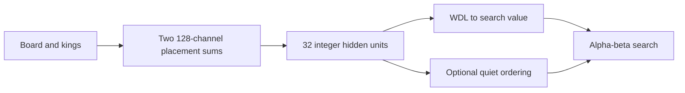

# FORGE 2

**Learned chess understanding, incremental integer evaluation, CPU alpha-beta search.**

By **Remmy Victor · [@vikta03](https://github.com/vikta03)**.

FORGE 2 learns from piece placements in two king-conditioned perspectives. A
128-channel placement representation feeds a 32-unit hidden layer, WDL evaluation
and an optional quiet-move policy. Playing uses C++ and AVX2 integer arithmetic,
one search thread and no GPU runtime. The search and chess rules are developed
from my Boring engine; ordinary evaluation bypasses its handcrafted concept score.

**[Read the complete engine book →](ENGINE_GUIDE.md)**

The single Markdown book follows the board representation, rules, every neural
layer, an actual evaluation, incremental updates, search heuristics, caches,
clocks, UCI options, compressed-data pipeline, training, export and experimental
evidence. It distinguishes active code from retained research code.



## Dedicated source release

**[FORGE 2 v2.0.0](https://github.com/vikta03/forge/releases/tag/v2.0.0)** contains
source, this book, the trained runtime weights, provenance and SHA256 checksums.
There is **no prebuilt executable** in this edition. The earlier
[FORGE netB v1.0.0](https://github.com/vikta03/forge/releases/tag/v1.0.0) remains
available independently; its source stays at the repository root.

Download `forge2-placement-source-2.0.0.tar.gz`, `placement.fg2` and `SHA256SUMS`
from the v2.0.0 release, then:

```bash
sha256sum --ignore-missing -c SHA256SUMS
tar -xzf forge2-placement-source-2.0.0.tar.gz
cp placement.fg2 forge2-placement-2.0.0/models/
cd forge2-placement-2.0.0
./build.sh
./forge2-policy
```

Requires Linux x86-64, a Haswell-compatible CPU (AVX2/FMA/BMI) and a C++20 GCC
compiler. The launcher locates the model relative to itself, including from
unrelated directories and paths containing spaces. `FORGE2_NET` or `--model`
overrides it; UCI `NetPath` remains available. No runtime framework libraries
are bundled or needed. The recipient builds against their own system libraries.

In a chess GUI, select `forge2-policy`, protocol UCI, and leave the working
directory blank. **Set `QuietPolicy=false` for the current evidence-supported
configuration.** The frozen source defaults to true to preserve the exact verified
policy integration. No weights or search defaults were silently changed for
publication. The engine identifies itself as `FORGE 2 Placement Policy (20261022)`.

## The trained model

- **213,899,602 retained examples per pass**, eight full-data passes, following a
  pilot warm start. Retained examples are not claimed globally unique.
- **4,238,688-byte runtime file**. It includes inactive relational reservations;
  this release is the placement architecture, not a trained relational engine.
- **3,181,504 parameters marked trainable**, including some inactive/unreachable
  slots. The exact table and active path are explained in the book.
- Full-validation WDL cross entropy improved **0.712624 → 0.646999** against the
  same teacher targets. This is improved teacher agreement, not an Elo claim.
- The compressed-data workflow completed the recorded eight-pass run in
  **2h 7m 58s** on the development laptop. It is not a promised runtime elsewhere.

The deployed model SHA256 is
`afd64230524c1ecfcd8bc87f3731e23252e4853f3199c9b312170f6994ecf9bc`.

## Policy experiment, including the unexciting part

A frozen 400-position comparison found policy on cost **4.6% paired NPS** and
**5.7% time to common depth**, with no mean depth gain. In 100 games at
**8 seconds per side per game + 0.08 seconds/move**, policy on scored
**23 wins / 55 draws / 22 losses**. The 50.5% score and approximate paired 95%
interval of 44.5–56.0% do not establish a strength gain or equivalence.

The book explains the design, why the smaller early sample was insufficient,
the runner's documented boundary-case amendment and the limits of the results.
[Evidence, fixtures and game scores](evidence/README.md) are included.

## Source and training

- [Complete engine guide](ENGINE_GUIDE.md)
- [Native source](src), [model/export tools](tools), [regression notes](tests/README.md)
- [Training source and required external inputs](training/README.md)
- [File provenance and hashes](SOURCE_PROVENANCE.json)
- [Licensing](LICENSE.md) and [third-party notices](THIRD_PARTY.md)

The runtime weights suffice to build and play. Exact retraining also needs the
external indexed teacher corpus, pilot checkpoint and pilot input-key cache;
those are not a complete downloadable training corpus in this repository.
Source publication performed static checks and preserved historical verification.
It did not launch a new build, training run, search benchmark or match.
